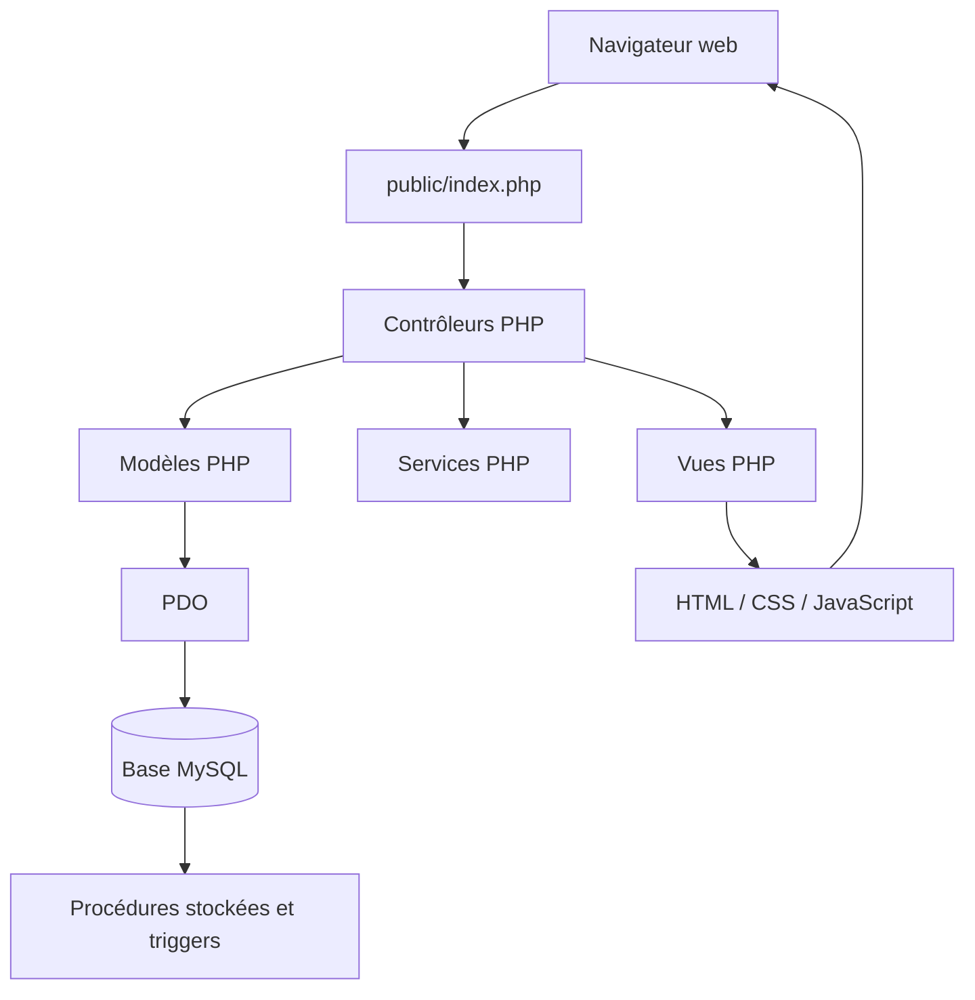
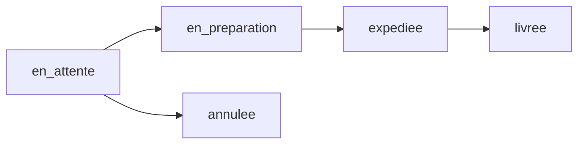

# 🛒 MiniShop

**MiniShop** est une application web de commerce électronique développée dans le cadre d'une **Situation d'Apprentissage et d'Évaluation (SAÉ) du BUT Informatique**.

Le projet est réalisé en **PHP et MySQL**, selon une architecture **MVC (Modèle-Vue-Contrôleur)**, afin de séparer la logique métier, l'accès aux données et l'affichage des pages.

L'application permet de consulter un catalogue de produits, de rechercher et filtrer les articles, de gérer un panier, de créer un compte client et d'accéder aux fonctionnalités liées aux commandes.

Elle comprend également un espace d'administration destiné à la gestion des produits, des catégories, des stocks et des commandes.

La base de données MySQL utilise des **procédures stockées**, des **triggers** et des **contraintes d'intégrité** pour centraliser certaines opérations et garantir le respect des règles métier.

## 📑 Sommaire

1. [Fonctionnalités](#fonctionnalités)
2. [Technologies utilisées](#technologies-utilisées)
3. [Architecture MVC](#architecture-mvc)
4. [Arborescence du projet](#arborescence-du-projet)
5. [Installation et configuration](#installation-et-configuration)
6. [Base de données](#base-de-données)
7. [Tests et validation](#tests-et-validation)
8. [Documentation](#documentation)
9. [Organisation du travail](#organisation-du-travail)
10. [État d'avancement et limites](#état-davancement-et-limites)
11. [Contexte universitaire](#contexte-universitaire)


## Fonctionnalités

MiniShop propose plusieurs fonctionnalités organisées autour de deux espaces : un espace destiné aux clients et un espace d'administration.

### Catalogue de produits

Le catalogue permet aux visiteurs de consulter les produits proposés par MiniShop.

Les fonctionnalités comprennent :

- L'affichage des produits actifs enregistrés dans MySQL.
- La consultation du nom, de la description, du prix et du stock.
- L'affichage des images associées aux produits.
- La recherche de produits par nom.
- Le filtrage des produits par catégorie.
- La consultation d'une fiche détaillée pour chaque produit.

Les données du catalogue sont récupérées depuis la base MySQL à travers les modèles PHP.

### Comptes clients et authentification

MiniShop dispose d'un système de gestion des comptes utilisateurs.

Il comprend :

- L'inscription de nouveaux clients.
- La connexion à un compte existant.
- La déconnexion.
- La gestion des sessions PHP.
- La consultation du profil utilisateur.
- La modification des informations personnelles.
- Le contrôle de l'unicité des adresses e-mail.
- La distinction entre les rôles client et administrateur.

Les mots de passe sont conservés sous forme de hachages dans la base de données.

### Panier

Le panier permet aux utilisateurs de préparer leurs achats avant la validation d'une commande.

Il propose :

- L'ajout de produits.
- L'augmentation et la diminution des quantités.
- La suppression d'un produit.
- Le calcul des sous-totaux.
- Le calcul du montant total.
- La conservation du panier dans une session PHP.
- Le contrôle des quantités par rapport au stock disponible.
- La protection des formulaires concernés par des jetons CSRF.

### Gestion des commandes

MiniShop possède les composants nécessaires à la gestion des commandes clients.

Les fonctionnalités prévues dans ce parcours comprennent :

- La validation du panier.
- L'enregistrement des commandes dans MySQL.
- L'enregistrement des lignes de commande.
- La consultation de l'historique des commandes.
- L'affichage du détail d'une commande.
- L'annulation d'une commande lorsque son statut l'autorise.
- La mise à jour des stocks en fonction des commandes.

Les vues et les composants PHP correspondants sont présents dans le projet. Leur validation fonctionnelle complète est suivie dans le document de tests.

### Espace d'administration

MiniShop comprend un espace d'administration organisé autour des produits, des catégories, des stocks et des commandes.

Les fonctionnalités associées comprennent :

- La consultation du tableau de bord administrateur.
- La gestion des catégories.
- L'ajout et la modification des produits.
- L'activation et la désactivation des produits.
- La gestion des images des produits.
- La consultation et la modification des stocks.
- La consultation des commandes.
- La modification du statut des commandes.
- La consultation de l'historique des changements de statut.

Ces opérations s'appuient notamment sur les modèles d'administration et les procédures stockées MySQL.

### Règles métier et sécurité

Plusieurs contrôles sont mis en place au niveau de l'application et de la base de données.

Ils concernent notamment :

- La validation des données transmises par les formulaires.
- La protection des opérations sensibles par des contrôles d'accès.
- La protection CSRF des formulaires concernés.
- L'utilisation de PDO pour les échanges avec MySQL.
- La vérification des prix et des stocks.
- Le refus des commandes dépassant les quantités disponibles.
- Le contrôle des transitions entre les statuts des commandes.
- La restitution du stock lors d'une annulation autorisée.
- L'enregistrement des changements de statut dans un historique.

Les procédures stockées et les triggers permettent d'appliquer une partie de ces règles directement dans MySQL.

### Limite du projet

MiniShop est une application développée dans un cadre pédagogique.

**Aucun système de paiement bancaire réel n'est intégré.**

Les fonctionnalités de commande et d'administration nécessitent également la réalisation ou la confirmation de certains tests, détaillés dans la documentation du projet.


## Technologies utilisées

MiniShop est développé avec plusieurs technologies permettant de gérer l'interface utilisateur, la logique métier, les données et la documentation du projet.

### Technologies principales

| Technologie | Utilisation dans MiniShop |
|---|---|
| **PHP** | Développement côté serveur, contrôleurs, modèles, services et gestion des sessions |
| **MySQL** | Stockage des clients, catégories, produits, commandes et historiques |
| **PDO** | Communication entre PHP et MySQL et exécution des requêtes SQL |
| **HTML5** | Structure des pages et des formulaires |
| **CSS3** | Mise en forme du catalogue, du panier, des comptes et de l'administration |
| **JavaScript** | Comportements interactifs côté navigateur |

### Architecture et organisation

| Outil ou principe | Utilisation |
|---|---|
| **MVC** | Séparation des modèles, des vues et des contrôleurs |
| **PHP orienté objet** | Organisation des composants de l'application en classes |
| **Sessions PHP** | Gestion de la connexion utilisateur et du panier |
| **Procédures stockées MySQL** | Centralisation de certaines opérations sur les données |
| **Triggers MySQL** | Application automatique de règles métier |
| **Git** | Gestion des versions du code source |
| **GitLab** | Hébergement du dépôt et collaboration en binôme |

### Documentation et développement

| Outil | Utilisation |
|---|---|
| **Visual Studio Code** | Développement et modification des fichiers du projet |
| **phpMyAdmin** | Administration de la base de données et exécution des tests SQL |
| **PlantUML** | Réalisation des diagrammes de conception et de modélisation |
| **Markdown** | Rédaction du README et de la documentation technique |

### Organisation des ressources

Les ressources de l'application sont séparées selon leur rôle :

- Les fichiers PHP de l'application se trouvent dans `app/`.
- Les paramètres de connexion à la base de données se trouvent dans `config/`.
- Les scripts SQL sont regroupés dans `database/`.
- Les fichiers CSS, JavaScript et les images sont accessibles depuis `public/`.
- La documentation technique et les diagrammes UML sont conservés dans `docs/`.

Cette organisation facilite la maintenance du projet et respecte le principe de séparation des responsabilités de l'architecture MVC.


## Architecture MVC

MiniShop repose sur une architecture **MVC (Modèle-Vue-Contrôleur)**, qui permet de séparer les responsabilités de l'application.

Cette organisation facilite la maintenance du code, son évolution et le travail collaboratif.

### Principe de fonctionnement

L'architecture repose sur trois composants principaux :

| Composant | Rôle | Emplacement |
|---|---|---|
| **Modèle (Model)** | Accéder aux données et exécuter les opérations nécessaires | `app/models/` |
| **Vue (View)** | Afficher les informations et les formulaires HTML | `app/views/` |
| **Contrôleur (Controller)** | Recevoir les requêtes, coordonner les traitements et sélectionner les vues | `app/controllers/` |

Le fichier `public/index.php` constitue le **point d'entrée de l'application**.

Il reçoit les requêtes HTTP et permet de diriger leur traitement vers les composants concernés.

### Schéma de fonctionnement



Ce schéma représente les principales interactions de l'application. Les procédures stockées et les triggers interviennent au niveau de MySQL : les procédures peuvent être appelées depuis PHP, tandis que les triggers s'exécutent automatiquement lors des opérations SQL concernées.

### Contrôleurs

Les contrôleurs sont regroupés dans `app/controllers/`.

| Contrôleur | Responsabilité principale |
|---|---|
| `ProduitController.php` | Catalogue, recherche et consultation des produits |
| `PanierController.php` | Gestion du panier |
| `AuthController.php` | Inscription, connexion et gestion de l'authentification |
| `CommandeController.php` | Parcours de commande et consultation des commandes |
| `AdminController.php` | Fonctionnalités de l'espace d'administration |

### Modèles

Les modèles sont regroupés dans `app/models/`.

| Modèle | Responsabilité principale |
|---|---|
| `Produit.php` | Accès aux produits du catalogue |
| `Categorie.php` | Accès aux catégories |
| `Client.php` | Gestion des données des clients |
| `Commande.php` | Accès aux commandes des clients |
| `ProduitAdmin.php` | Opérations administratives sur les produits |
| `CommandeAdmin.php` | Opérations administratives sur les commandes |

Les modèles assurent la communication avec MySQL à l'aide de PDO.

Certaines opérations utilisent les procédures stockées définies dans les scripts SQL du projet.

### Vues

Les vues sont regroupées dans `app/views/` et organisées selon les fonctionnalités :

| Dossier | Contenu |
|---|---|
| `produits/` | Catalogue et fiches produits |
| `panier/` | Consultation et gestion du panier |
| `auth/` | Connexion et inscription |
| `compte/` | Profil utilisateur |
| `commandes/` | Validation, confirmation, historique et détails des commandes |
| `admin/` | Pages de gestion de l'administration |

Les vues génèrent les pages HTML affichées dans le navigateur et utilisent les ressources CSS et JavaScript présentes dans `public/`.

### Services

Le dossier `app/services/` contient actuellement :

- `ImageProduitService.php` : service dédié aux traitements liés aux images des produits.

L'utilisation d'un service permet d'isoler un traitement spécifique sans le placer directement dans un contrôleur ou une vue.

### Séparation des responsabilités

L'architecture MVC de MiniShop permet de distinguer :

- **La présentation**, assurée par les vues et les ressources publiques.
- **Le traitement des requêtes**, assuré par les contrôleurs.
- **L'accès aux données**, assuré par les modèles.
- **Les traitements spécifiques**, regroupés dans les services.
- **Les règles métier SQL**, appliquées notamment par les procédures stockées, les contraintes et les triggers MySQL.

Cette séparation rend le projet plus lisible et facilite l'ajout de nouvelles fonctionnalités.


## Arborescence du projet

Le projet MiniShop est organisé en plusieurs dossiers afin de séparer le code PHP, les ressources publiques, les scripts SQL et la documentation.

L'arborescence principale est la suivante :

```text
minishop/
├── app/
│   ├── controllers/
│   │   ├── AdminController.php
│   │   ├── AuthController.php
│   │   ├── CommandeController.php
│   │   ├── PanierController.php
│   │   └── ProduitController.php
│   │
│   ├── models/
│   │   ├── Categorie.php
│   │   ├── Client.php
│   │   ├── Commande.php
│   │   ├── CommandeAdmin.php
│   │   ├── Produit.php
│   │   └── ProduitAdmin.php
│   │
│   ├── services/
│   │   └── ImageProduitService.php
│   │
│   └── views/
│       ├── admin/
│       ├── auth/
│       ├── commandes/
│       ├── compte/
│       ├── panier/
│       └── produits/
│
├── config/
│   ├── database-example.php
│   └── database.php
│
├── database/
│   ├── ajout_image_produit.sql
│   ├── data.sql
│   ├── procedures.sql
│   ├── procedures_admin.sql
│   ├── schema.sql
│   ├── schema_admin.sql
│   ├── triggers.sql
│   └── triggers_admin.sql
│
├── docs/
│   ├── conception-bdd.md
│   ├── specification.md
│   ├── tests-validation.md
│   └── uml/
│       ├── *.puml
│       └── *.png
│
├── public/
│   ├── css/
│   │   ├── admin.css
│   │   └── style.css
│   ├── images/
│   ├── js/
│   │   └── app.js
│   └── index.php
│
├── tests/
│   └── .gitkeep
│
├── .gitignore
└── README.md
```

Cette arborescence présente les principaux fichiers et dossiers du projet. Le contenu détaillé des vues, des images et des diagrammes UML est volontairement abrégé afin de conserver une présentation lisible.

### Rôle des principaux dossiers

| Dossier | Rôle |
|---|---|
| `app/controllers/` | Traitement des requêtes et coordination des fonctionnalités |
| `app/models/` | Accès aux données MySQL et opérations sur les entités |
| `app/services/` | Traitements spécifiques, notamment la gestion des images |
| `app/views/` | Pages et composants d'affichage |
| `config/` | Configuration de la connexion à la base de données |
| `database/` | Scripts de structure, de données, de procédures et de triggers |
| `docs/` | Documentation fonctionnelle et technique |
| `docs/uml/` | Diagrammes de modélisation |
| `public/` | Point d'entrée web et ressources accessibles au navigateur |
| `tests/` | Emplacement réservé aux futurs tests automatisés |

### Configuration locale

Le dossier `config/` contient deux fichiers importants :

- `database-example.php` : exemple de configuration permettant de préparer la connexion à MySQL.
- `database.php` : configuration locale utilisée par l'application.

Le fichier `database.php` peut contenir des identifiants de connexion. Il doit donc être exclu du versionnement Git lorsqu'il contient des informations sensibles.

### Ressources publiques

Le dossier `public/` contient les éléments accessibles depuis le navigateur :

- `index.php` : point d'entrée de l'application.
- `css/style.css` : styles généraux.
- `css/admin.css` : styles de l'administration.
- `js/app.js` : scripts JavaScript.
- `images/` : images utilisées par l'application, notamment celles des produits.

### Dossier de tests

Le dossier `tests/` est actuellement réservé à l'ajout éventuel de tests automatisés.

Il contient uniquement un fichier `.gitkeep`, qui permet de conserver le dossier dans le dépôt Git même lorsqu'il est vide.

Les tests SQL et les vérifications fonctionnelles sont, pour le moment, documentés dans `docs/tests-validation.md`.


## Installation et configuration

Cette section présente les étapes nécessaires pour installer MiniShop sur un environnement local.

### Prérequis

Pour exécuter l'application, il faut disposer des éléments suivants :

| Outil | Utilisation |
|---|---|
| **PHP** | Exécution de l'application côté serveur |
| **Extension PDO MySQL** | Connexion entre PHP et MySQL |
| **MySQL** | Hébergement de la base de données |
| **Serveur web compatible PHP** | Accès à l'application depuis un navigateur |
| **phpMyAdmin** | Administration et importation des scripts SQL (facultatif) |
| **Git** | Récupération du dépôt GitLab |

Un environnement local tel que XAMPP, WampServer ou Laragon peut être utilisé.

### 1. Récupérer le projet

Cloner le dépôt GitLab :

```bash
git clone <url-du-depot-gitlab>
```

Accéder ensuite au dossier du projet :

```bash
cd minishop
```

L'adresse `<url-du-depot-gitlab>` doit être remplacée par l'URL réelle du dépôt.

### 2. Créer la base de données

Créer une base de données MySQL nommée `minishop`.

Depuis phpMyAdmin, ouvrir l'onglet **SQL** et exécuter :

```sql
CREATE DATABASE IF NOT EXISTS minishop
CHARACTER SET utf8mb4
COLLATE utf8mb4_unicode_ci;
```

Sélectionner ensuite la base `minishop` avant d'importer les scripts SQL.

Le nom de la base peut être différent selon l'environnement d'installation. Dans ce cas, il doit correspondre à celui indiqué dans la configuration PHP.

### 3. Préparer la base de données

Les scripts SQL du projet sont regroupés dans le dossier `database/`.

| Fichier | Rôle |
|---|---|
| `schema.sql` | Création de la structure principale de la base |
| `schema_admin.sql` | Compléments de structure liés à l'administration |
| `ajout_image_produit.sql` | Ajout de la gestion des images des produits |
| `procedures.sql` | Procédures stockées principales |
| `procedures_admin.sql` | Procédures stockées d'administration |
| `triggers.sql` | Triggers principaux |
| `triggers_admin.sql` | Triggers complémentaires |
| `data.sql` | Données de démonstration |

**Important :** certains scripts peuvent correspondre à des évolutions de la base plutôt qu'à des opérations à répéter lors de chaque installation.

Avant de les exécuter, il faut vérifier leur contenu et leurs dépendances, notamment pour éviter :

- De créer deux fois une même table ou une même colonne.
- D'exécuter une modification de structure déjà intégrée dans `schema.sql`.
- De créer des procédures ou des triggers avant les tables nécessaires.
- D'importer des données de démonstration plusieurs fois.
- De modifier involontairement les stocks lors de l'insertion des lignes de commande.

L'ordre d'importation définitif doit être établi à partir du contenu réel des scripts.

### 4. Configurer la connexion MySQL

Le dossier `config/` contient les fichiers suivants :

- `database-example.php` : modèle de configuration.
- `database.php` : configuration locale utilisée par MiniShop.

Si le fichier `database.php` n'existe pas, créer une copie de `database-example.php` et la renommer `database.php`.

Adapter ensuite les paramètres de connexion à l'environnement local :

- Hôte MySQL.
- Nom de la base de données.
- Nom d'utilisateur MySQL.
- Mot de passe MySQL.

**Sécurité :** le fichier `config/database.php` doit rester local lorsqu'il contient des identifiants sensibles. Vérifier qu'il est exclu du dépôt par `.gitignore`.

### 5. Démarrer l'application

Depuis la racine du projet, il est possible d'utiliser le serveur intégré de PHP :

```bash
php -S localhost:8000 -t public
```

Ouvrir ensuite l'adresse suivante dans un navigateur :

[http://localhost:8000](http://localhost:8000)

Le dossier `public/` constitue la racine web de l'application.

Le fichier `public/index.php` est son point d'entrée.

### 6. Vérifier l'installation

Après le démarrage, effectuer les vérifications suivantes :

1. La page d'accueil de MiniShop s'affiche.
2. Le catalogue récupère les produits depuis MySQL.
3. Les images des produits sont accessibles.
4. La recherche et le filtrage par catégorie fonctionnent.
5. Les pages d'inscription et de connexion sont accessibles.
6. Le panier permet d'ajouter et de modifier des quantités.
7. Aucune erreur de connexion MySQL n'est affichée.

Les fonctionnalités de commande et d'administration peuvent ensuite être vérifiées à l'aide des scénarios documentés dans le compte rendu des tests.

### 7. Précautions d'installation

Le fichier `data.sql` contient des données de démonstration.

Il ne doit pas être réexécuté sans préparation sur une base contenant déjà des enregistrements.

Les triggers peuvent modifier automatiquement certaines données, notamment les stocks lors de l'insertion des lignes de commande.

Pour effectuer des essais, il est recommandé d'utiliser une base de test et de conserver une sauvegarde des données initiales.


## Base de données

MiniShop utilise une base de données relationnelle **MySQL** pour stocker les informations nécessaires au fonctionnement de l'application.

La base gère les clients, les catégories, les produits, les commandes ainsi que l'historique des changements de statut.

La communication entre l'application PHP et MySQL est assurée par **PDO**.

### Structure de la base de données

La base MiniShop comprend **six tables principales**.

| Table | Rôle |
|---|---|
| `CLIENT` | Stockage des comptes clients et administrateurs |
| `CATEGORIE` | Organisation des produits par catégorie |
| `PRODUIT` | Informations du catalogue, prix, stock, état et image |
| `COMMANDE` | Enregistrement des commandes des clients |
| `LIGNE_COMMANDE` | Produits, quantités et prix associés aux commandes |
| `ORDER_STATUS_HISTORY` | Historique des changements de statut des commandes |

Les relations entre les tables sont assurées par des clés primaires et des clés étrangères.

La table `LIGNE_COMMANDE` utilise une clé primaire composée de l'identifiant de la commande et de l'identifiant du produit.

### Relations entre les tables

Les principales relations sont les suivantes :

- Un **client** peut effectuer plusieurs commandes.
- Une **catégorie** peut contenir plusieurs produits.
- Une **commande** peut contenir plusieurs lignes de commande.
- Un **produit** peut apparaître dans plusieurs lignes de commande.
- Une **commande** peut posséder plusieurs entrées dans son historique de statut.

Ces relations permettent d'organiser les données et de limiter les incohérences.

### Procédures stockées

MiniShop dispose de **17 procédures stockées**, réparties entre les fonctionnalités principales et l'administration.

| Groupe | Nombre | Fichier |
|---|---:|---|
| Procédures principales | 5 | `procedures.sql` |
| Procédures d'administration | 12 | `procedures_admin.sql` |
| **Total** | **17** | |

Les procédures principales permettent notamment :

- La recherche de produits.
- Le filtrage des produits par catégorie.
- La consultation des commandes d'un client.
- La consultation des lignes d'une commande.
- La modification du stock d'un produit.

Les procédures d'administration permettent notamment :

- L'ajout, la modification et la suppression de catégories.
- L'ajout et la modification de produits.
- L'activation et la désactivation de produits.
- La modification des images des produits.
- La modification du statut d'une commande.
- La consultation des produits, catégories et commandes.
- La consultation de l'historique des statuts.

Les procédures stockées centralisent certaines opérations SQL et facilitent leur réutilisation depuis l'application PHP.

### Triggers

MiniShop utilise **8 triggers** pour appliquer automatiquement certaines règles métier au niveau de MySQL.

| Groupe | Nombre | Fichier |
|---|---:|---|
| Triggers principaux | 5 | `triggers.sql` |
| Triggers complémentaires | 3 | `triggers_admin.sql` |
| **Total** | **8** | |

Les triggers assurent notamment :

- Le refus des prix non positifs.
- Le refus des stocks négatifs.
- La vérification des quantités lors d'une commande.
- La diminution du stock après l'insertion d'une ligne de commande.
- L'interdiction de modifier une ligne de commande existante.
- Le contrôle des changements de statut des commandes.
- La restitution du stock lors d'une annulation autorisée.
- L'enregistrement des changements de statut dans l'historique.
- Le refus des noms de catégories vides.

Ces contrôles complètent les vérifications réalisées dans le code PHP.

### Gestion des statuts des commandes

Les commandes utilisent les statuts suivants :

| Statut | Signification |
|---|---|
| `en_attente` | Commande enregistrée, en attente de traitement |
| `en_preparation` | Commande en cours de préparation |
| `expediee` | Commande expédiée |
| `livree` | Commande livrée |
| `annulee` | Commande annulée |

Les transitions autorisées sont contrôlées par un trigger MySQL.



Une commande livrée ou annulée ne peut plus changer de statut selon les règles définies.

Lorsqu'une commande en attente est annulée, les quantités correspondantes sont restituées au stock.

Les changements de statut sont enregistrés dans la table `ORDER_STATUS_HISTORY`.

### Données de démonstration

Le fichier `database/data.sql` prévoit un jeu de données destiné aux tests.

| Élément | Quantité prévue |
|---|---:|
| Catégories | 3 |
| Produits | 15 |
| Comptes de démonstration | 3 |
| Commandes | 2 |
| Lignes de commande | 3 |

Les quinze produits sont répartis entre trois catégories :

- **Informatique** : 5 produits.
- **Téléphonie** : 5 produits.
- **Accessoires** : 5 produits.

Ces données permettent de tester le catalogue, les recherches, les comptes clients et les commandes.

**Attention :** le script `data.sql` ne doit pas être réimporté sans préparation dans une base contenant déjà des données.


### Scripts SQL du projet

Les fichiers SQL sont regroupés dans le dossier `database/`.

Pour une installation sur une **base de données vide**, importer les fichiers dans l'ordre suivant :

| Ordre | Fichier | Utilisation |
|---|---|---|
| 1 | `schema.sql` | Création des cinq tables principales |
| 2 | `schema_admin.sql` | Création de la table d'historique des commandes |
| 3 | `procedures.sql` | Création des cinq procédures principales |
| 4 | `procedures_admin.sql` | Création des douze procédures d'administration |
| 5 | `triggers.sql` | Création des cinq triggers principaux |
| 6 | `triggers_admin.sql` | Création des trois triggers complémentaires |
| 7 | `data.sql` | Insertion des données de démonstration et association des images |

**Important :** cet ordre est prévu pour une installation neuve. Les scripts de création ne doivent pas être réexécutés sans précaution sur une base contenant déjà les mêmes tables, procédures ou triggers.

Le fichier `ajout_image_produit.sql` est conservé comme ancien script de migration. Il ne doit pas être exécuté lors d'une installation neuve, car la colonne `image` existe déjà dans `schema.sql`.

Les triggers doivent être installés avant `data.sql` afin que les stocks soient correctement mis à jour lors de l'insertion des commandes de démonstration.

### Documentation de la base de données

La conception détaillée de la base est disponible dans le document :

[**Conception de la base de données — MiniShop**](docs/conception-bdd.md)

Ce document présente notamment :

- Le modèle conceptuel de données (MCD).
- Le modèle logique de données (MLD).
- Les relations entre les tables.
- Les contraintes d'intégrité.
- Les procédures stockées.
- Les triggers.
- Les choix de conception et de normalisation.

Les diagrammes UML associés sont disponibles dans `docs/uml/`.


## Tests et validation

MiniShop fait l'objet de vérifications visant à contrôler le fonctionnement de l'application PHP, les échanges avec MySQL et le respect des règles métier.

Les tests sont répartis en deux catégories :

- **Tests SQL** : vérification des procédures stockées, des triggers, des contraintes et des données.
- **Tests d'intégration PHP/MySQL** : vérification des fonctionnalités depuis l'interface de l'application.

### Tests SQL

Le plan de validation comprend **39 tests SQL fonctionnels**.

Ils couvrent notamment :

- La recherche et le filtrage des produits.
- La consultation des commandes et de leurs lignes.
- La modification et le contrôle des stocks.
- Le refus des prix et des quantités invalides.
- Les opérations d'administration sur les catégories et les produits.
- La gestion des images des produits.
- Les transitions entre les statuts des commandes.
- La restitution du stock lors d'une annulation.
- L'historisation des changements de statut.
- Le fonctionnement des transactions SQL.

L'état des vérifications documentées est le suivant :

| État | Nombre de tests |
|---|---:|
| Confirmés depuis l'application PHP | 2 |
| Résultats SQL à confirmer | 12 |
| Tests complémentaires à réaliser | 25 |
| **Total** | **39** |

Les deux tests confirmés depuis PHP concernent la recherche de produits et le filtrage par catégorie.

Ces résultats ne constituent pas une validation directe de toutes les procédures stockées et de tous les triggers dans phpMyAdmin.

### Tests d'intégration PHP/MySQL

Le suivi initial comprend **15 tests d'intégration**.

| État | Nombre de tests |
|---|---:|
| Réussis | 11 |
| À réaliser | 4 |
| **Total** | **15** |

Les fonctionnalités déjà vérifiées concernent principalement :

- L'affichage du catalogue.
- La recherche et le filtrage des produits.
- La consultation des fiches produits.
- L'inscription et la connexion.
- La consultation et la modification du profil.
- Le contrôle de l'unicité des adresses e-mail.
- La gestion du panier.
- Le contrôle des quantités disponibles.

Les vérifications restant à compléter dans le suivi initial concernent :

- La validation d'une commande depuis PHP.
- La consultation de l'historique des commandes.
- L'annulation d'une commande.
- Les fonctionnalités d'administration.

### Méthode de validation

Pour chaque test, le compte rendu précise, selon les informations disponibles :

1. L'objectif du test.
2. La requête SQL ou le scénario exécuté.
3. Le résultat attendu.
4. Le résultat observé.
5. Le statut de validation.

Les tests susceptibles de modifier les données doivent être effectués sur une base dédiée, en tenant compte des effets automatiques des triggers.

### Tests automatisés

Le projet contient un dossier `tests/` réservé à l'ajout éventuel de tests automatisés.

Ce dossier contient actuellement uniquement un fichier `.gitkeep`.

**Aucune suite de tests automatisés n'est donc présentée comme opérationnelle à ce stade.**

Les vérifications existantes sont documentées dans le compte rendu de tests.

### Compte rendu détaillé

L'ensemble des scénarios, des requêtes SQL et des résultats de validation est présenté dans le document :

[**Compte rendu des tests SQL — MiniShop**](docs/tests-validation.md)

Ce document permet de suivre les tests déjà confirmés et ceux qui restent à réaliser.


## Documentation

La documentation de MiniShop est regroupée dans le dossier `docs/`.

Elle présente les besoins du projet, la conception de la base de données et les vérifications effectuées.

### Documents du projet

| Document | Description |
|---|---|
| [Spécification du système](docs/specification.md) | Présentation du projet, des besoins, des fonctionnalités attendues et des règles de gestion |
| [Conception de la base de données](docs/conception-bdd.md) | Description du modèle de données, des tables, des relations, des procédures stockées et des triggers |
| [Compte rendu des tests SQL](docs/tests-validation.md) | Présentation des scénarios de test, des résultats attendus, des vérifications réalisées et des tests restant à effectuer |

### Diagrammes de conception

Le dossier `docs/uml/` regroupe les diagrammes réalisés pour représenter la structure et le fonctionnement du système.

Les diagrammes sont conservés sous deux formats :

- **`.puml`** : fichiers sources PlantUML, modifiables pour faire évoluer les diagrammes.
- **`.png`** : images générées à partir des diagrammes, consultables sans installer PlantUML.

Le diagramme conceptuel de données (MCD) présente notamment les principales entités de MiniShop et leurs relations.

Les autres diagrammes permettent de compléter la documentation de conception selon les fonctionnalités représentées.

### Organisation de la documentation

```text
docs/
├── specification.md
├── conception-bdd.md
├── tests-validation.md
└── uml/
    ├── *.puml
    └── *.png
```

### Consultation et mise à jour

Les documents Markdown peuvent être consultés directement depuis GitLab.

Les diagrammes PNG peuvent également être affichés dans le navigateur.

Pour modifier un diagramme PlantUML, il est possible d'ouvrir son fichier `.puml` dans un éditeur compatible, puis de générer à nouveau l'image correspondante.

La documentation doit être mise à jour lorsque des changements importants sont apportés :

- Aux fonctionnalités de l'application.
- À la structure de la base de données.
- Aux procédures stockées et aux triggers.
- Aux règles métier.
- Aux résultats des tests.

Cette organisation permet de conserver une documentation cohérente avec l'évolution du projet MiniShop.


## Organisation du travail

MiniShop est un projet réalisé **en binôme** dans le cadre d'une SAÉ du BUT Informatique.

Le développement repose sur une organisation collaborative permettant de répartir les fonctionnalités, de suivre les modifications et de conserver un historique du code source.

### Gestion du code source

Le projet utilise **Git** pour le versionnement et **GitLab** pour l'hébergement du dépôt.

Ces outils permettent notamment :

- De conserver l'historique des modifications.
- De travailler sur différentes fonctionnalités.
- De partager le code entre les membres du binôme.
- De suivre l'évolution du projet.
- De faciliter l'intégration des modifications.

### Organisation des branches

Les branches Git permettent d'isoler le développement de certaines fonctionnalités avant leur intégration dans la branche principale.

Une convention de nommage peut être utilisée :

| Préfixe | Utilisation | Exemple |
|---|---|---|
| `feature/` | Développement d'une fonctionnalité | `feature/gestion-commandes` |
| `fix/` | Correction d'un problème | `fix/controle-stock` |
| `docs/` | Modification de la documentation | `docs/mise-a-jour-readme` |

Cette convention facilite l'identification du rôle de chaque branche.

### Organisation des commits

Les messages de commit doivent décrire clairement les modifications réalisées.

Une convention simple peut être adoptée :

| Préfixe | Signification | Exemple |
|---|---|---|
| `feat:` | Ajout d'une fonctionnalité | `feat: ajout de la gestion des commandes` |
| `fix:` | Correction d'un problème | `fix: correction du controle des stocks` |
| `docs:` | Mise à jour de la documentation | `docs: actualisation du README` |
| `refactor:` | Réorganisation du code sans changement fonctionnel | `refactor: simplification du controleur produit` |
| `style:` | Modification de la présentation | `style: amelioration de l'interface admin` |

Ces conventions servent à rendre l'historique Git plus lisible.

### Répartition du travail

Le travail en binôme permet de répartir les différentes parties du projet, notamment :

- Le développement des fonctionnalités PHP.
- La conception et l'évolution de la base MySQL.
- La création des vues et des ressources CSS et JavaScript.
- La mise en place des fonctionnalités d'administration.
- La réalisation des tests.
- La rédaction et la mise à jour de la documentation.

Les modifications doivent être vérifiées avant leur intégration afin de limiter les conflits et les régressions.

### Suivi et documentation

Le dépôt GitLab centralise le code source, les scripts SQL et les documents techniques.

Les fichiers présents dans `docs/` permettent de suivre :

- Les besoins et les fonctionnalités du projet.
- Les choix de conception de la base de données.
- Les tests SQL et les vérifications fonctionnelles.

Le fichier `README.md` constitue le point d'entrée de cette documentation et doit rester cohérent avec la structure actuelle du projet.


## État d'avancement et limites

MiniShop dispose d'une architecture MVC, d'une base de données MySQL et de plusieurs fonctionnalités destinées aux clients et aux administrateurs.

Le développement du projet a progressivement intégré le catalogue, la gestion des comptes, le panier, les commandes et l'administration.

### État d'avancement des fonctionnalités

Le tableau suivant distingue les fonctionnalités déjà vérifiées de celles qui nécessitent encore une validation complète.

| Fonctionnalité | État |
|---|---|
| Affichage du catalogue | Fonctionnel et testé |
| Recherche de produits | Fonctionnelle et testée |
| Filtrage par catégorie | Fonctionnel et testé |
| Consultation des fiches produits | Fonctionnelle et testée |
| Inscription des clients | Fonctionnelle et testée |
| Connexion et authentification | Fonctionnelles et testées |
| Consultation du profil | Fonctionnelle et testée |
| Modification du profil | Fonctionnelle et testée |
| Gestion du panier | Fonctionnelle et testée |
| Contrôle des quantités disponibles | Fonctionnel et testé |
| Validation des commandes | Développée, validation complète à confirmer |
| Historique des commandes | Composants présents, validation à confirmer |
| Annulation des commandes | Composants présents, validation à confirmer |
| Gestion des produits et catégories | Composants d'administration présents, validation à confirmer |
| Gestion des images des produits | Service et éléments SQL présents, validation à confirmer |
| Gestion des statuts des commandes | Règles SQL présentes, tests complémentaires à réaliser |

Les états indiqués correspondent au suivi de validation documenté dans le projet.

La présence d'un composant PHP ou d'une procédure SQL ne signifie pas automatiquement que tous les scénarios associés ont été testés.

### Avancement de la base de données

La structure SQL de MiniShop comprend :

- **6 tables** relationnelles.
- **17 procédures stockées**.
- **8 triggers**.
- Des contraintes d'intégrité.
- Un jeu de données de démonstration.
- Un historique des changements de statut des commandes.

La présence des procédures stockées et des triggers a été vérifiée dans MySQL.

Les tests complémentaires prévus doivent permettre de confirmer leur comportement dans les différents scénarios métier.

### Limites actuelles

MiniShop est développé dans un cadre pédagogique et comporte certaines limites.

**Paiement bancaire**

Aucun système de paiement bancaire réel n'est intégré.

**Validation des fonctionnalités**

Certains parcours liés aux commandes et à l'administration nécessitent encore des tests complets.

**Tests automatisés**

Le dossier `tests/` est actuellement réservé à de futurs tests automatisés. Il ne contient pas encore de suite de tests exécutable.

**Déploiement**

La documentation présente principalement une installation en environnement local. Un déploiement en production nécessiterait des vérifications supplémentaires de configuration, de sécurité et de fonctionnement.

### Améliorations envisageables

Plusieurs évolutions pourraient compléter le projet :

- Ajouter des tests automatisés pour les modèles et les principales règles métier.
- Finaliser et documenter les scénarios de validation des commandes.
- Compléter les tests de l'espace d'administration.
- Renforcer la vérification des droits d'accès.
- Améliorer la gestion et la validation des images des produits.
- Préparer une procédure de déploiement reproductible.
- Maintenir à jour la documentation en fonction des évolutions du code.

### Bilan

MiniShop possède les principaux composants d'une application de commerce électronique développée en PHP MVC.

Les fonctionnalités du catalogue, des comptes clients et du panier disposent de résultats de tests positifs.

Les composants liés aux commandes et à l'administration sont également présents, mais leur validation complète doit être confirmée.

Le projet constitue ainsi une base fonctionnelle et évolutive, dont les vérifications restantes sont identifiées dans le compte rendu des tests.


## Contexte universitaire

MiniShop est un projet réalisé dans le cadre d'une **Situation d'Apprentissage et d'Évaluation (SAÉ) du Bachelor Universitaire de Technologie (BUT) Informatique**.

Le projet est développé **en binôme** et permet de mettre en pratique les connaissances acquises au cours de la formation à travers la conception et le développement d'une application web de commerce électronique.

### Objectifs pédagogiques

La réalisation de MiniShop mobilise plusieurs compétences :

- **Développement web** : création d'une application dynamique avec PHP, HTML, CSS et JavaScript.
- **Programmation orientée objet** : organisation du code à l'aide de classes PHP.
- **Architecture logicielle** : application du modèle MVC pour séparer les responsabilités.
- **Bases de données** : conception d'un schéma relationnel MySQL et manipulation des données.
- **Programmation SQL** : utilisation de procédures stockées, de triggers et de contraintes d'intégrité.
- **Sécurité applicative** : gestion des sessions, authentification, contrôle des accès et protection des formulaires.
- **Tests et validation** : définition de scénarios de test et vérification du respect des règles métier.
- **Gestion de projet** : organisation du travail en binôme et utilisation de Git et GitLab.
- **Documentation technique** : rédaction des spécifications, de la conception de la base et des comptes rendus de tests.

### Démarche de réalisation

Le développement du projet s'appuie sur plusieurs étapes :

1. Analyse des besoins et rédaction des spécifications.
2. Conception de la base de données et réalisation des diagrammes.
3. Mise en place de l'architecture MVC.
4. Développement des fonctionnalités destinées aux clients.
5. Développement des composants d'administration.
6. Mise en place des procédures stockées et des triggers.
7. Réalisation des tests et vérification des règles métier.
8. Rédaction et actualisation de la documentation.

Cette démarche permet de relier la conception, l'implémentation et la validation d'un système informatique.

### Finalité du projet

MiniShop a pour objectif de proposer une application de commerce électronique structurée, maintenable et évolutive.

Le projet constitue un support pédagogique permettant de mettre en pratique le développement d'une application web complète, de son interface utilisateur jusqu'à sa base de données.

**MiniShop est un projet universitaire à vocation pédagogique et ne constitue pas une plateforme commerciale de vente en ligne.**
