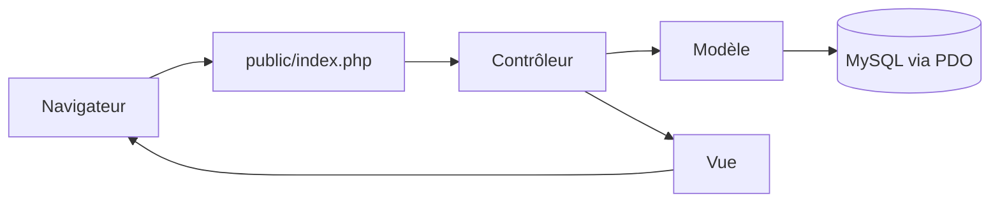

#  MiniShop

Application web de commerce électronique développée en **PHP / MySQL** avec une architecture **MVC**, dans le cadre d'une SAÉ du BUT Informatique.

MiniShop permet de consulter un catalogue de produits, de gérer un panier et, à terme, de passer des commandes.

## Sommaire

- [Fonctionnalités](#fonctionnalités)
- [Technologies](#technologies)
- [Architecture](#architecture)
- [Installation](#installation)
- [Tests](#tests)
- [Documentation](#documentation)
- [Organisation du travail](#organisation-du-travail)
- [État d'avancement](#état-davancement)
- [Contexte](#contexte)

## Fonctionnalités

### Réalisées

**Catalogue de produits**

- Affichage des produits actifs depuis la base MySQL
- Présentation du nom, de la description, du prix, du stock et de l'image de chaque produit
- Interface responsive avec un design violet

**Panier**

- Ajout de produits au panier
- Conservation du panier grâce aux sessions PHP
- Calcul automatique des sous-totaux et du total
- Augmentation, diminution et suppression des quantités
- Vérification du stock disponible
- Protection des formulaires par jeton CSRF

**Base de données**

- Gestion des clients, catégories, produits, commandes et lignes de commande
- Contraintes d'intégrité
- Procédures stockées
- Triggers pour certaines règles métier
- Jeux de données de test

### Prévues

- [ ] Inscription et connexion des clients
- [ ] Gestion des comptes utilisateurs
- [ ] Validation des commandes
- [ ] Historique des commandes
- [ ] Interface d'administration (gestion des produits et des catégories)

> Le paiement bancaire réel n'est pas implémenté.

## Technologies

| Technologie | Utilisation |
|---|---|
| PHP | Développement côté serveur |
| MySQL | Gestion de la base de données |
| PDO | Communication sécurisée entre PHP et MySQL |
| HTML5 / CSS3 | Structure et mise en forme des pages |
| JavaScript | Évolutions possibles de l'interface |
| Git / GitLab | Versionnement et travail collaboratif |
| PlantUML | Modélisation UML |

## Architecture

Le projet suit le modèle **MVC** : le contrôleur reçoit la requête, interroge le modèle, puis affiche la vue.



### Arborescence

```text
minishop/
├── app/
│   ├── controllers/
│   │   ├── ProduitController.php    # Catalogue
│   │   └── PanierController.php     # Panier
│   ├── models/
│   │   └── Produit.php              # Accès aux produits
│   └── views/
│       ├── produits/index.php
│       └── panier/index.php
├── config/
│   └── database.php                 # Connexion MySQL (local, non versionné)
├── database/
│   ├── schema.sql                   # Tables et contraintes
│   ├── procedures.sql               # Procédures stockées
│   ├── triggers.sql                 # Triggers
│   └── data.sql                     # Jeux de données de test
├── docs/
│   ├── specification.md
│   └── tests-validation.md
├── public/
│   ├── css/style.css
│   ├── images/
│   └── index.php                    # Point d'entrée
├── .gitignore
└── README.md
```

## Installation

### Prérequis

- PHP avec l'extension **PDO MySQL**
- Un serveur MySQL
- Un serveur web compatible PHP (ou le serveur intégré de PHP)
- Git

### Étapes

**1. Récupérer le dépôt**

```bash
git clone <url-du-depot-gitlab>
cd minishop
```

**2. Créer la base de données**

```bash
mysql -u root -p -e "CREATE DATABASE minishop CHARACTER SET utf8mb4;"
```

**3. Exécuter les scripts SQL dans cet ordre**

```bash
mysql -u root -p minishop < database/schema.sql
mysql -u root -p minishop < database/procedures.sql
mysql -u root -p minishop < database/triggers.sql
mysql -u root -p minishop < database/data.sql
```

> Tu peux aussi importer ces 4 fichiers, dans le même ordre, avec phpMyAdmin.

**4. Configurer la connexion**

Renseigne dans `config/database.php` les paramètres de ta base : hôte, nom de la base, utilisateur et mot de passe.

>  Ce fichier contient des informations locales sensibles : il est exclu du suivi Git par le `.gitignore`. Ne le pousse jamais sur GitLab.

**5. Lancer l'application**

Configure ton serveur web pour qu'il serve `public/index.php`, ou utilise le serveur intégré de PHP :

```bash
php -S localhost:8000 -t public
```

Ouvre ensuite <http://localhost:8000> dans ton navigateur.

## Tests

Les tests réalisés portent sur :

- la recherche de produits
- la récupération des produits par catégorie
- la consultation des commandes
- les contraintes de prix et de stock
- la vérification des transitions de statut
- les procédures stockées et les triggers

Le détail des tests SQL est dans [`docs/tests-validation.md`](docs/tests-validation.md).

## Documentation

| Document | Contenu |
|---|---|
| [`docs/specification.md`](docs/specification.md) | Cahier des charges / spécification du système |
| [`docs/tests-validation.md`](docs/tests-validation.md) | Tests SQL et validation |

## Organisation du travail

Le projet est développé **en binôme** sur GitLab.

- Chaque fonctionnalité est développée sur une **branche dédiée** (exemple : `feature/minishop-mvc-panier`), puis intégrée après vérification.
- Les commits sont organisés par fonctionnalité, avec des messages clairs (par exemple `feat: ajout du panier`, `fix: calcul du total`), afin de garder un historique lisible.

## État d'avancement

- Catalogue fonctionnel
- Panier fonctionnel
- Authentification
- Validation des commandes
- Administration

## Contexte

Projet universitaire : SAÉ, BUT Informatique.