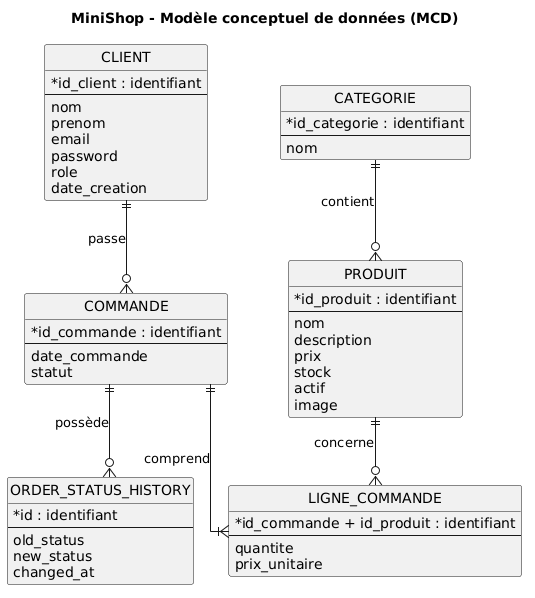

# MiniShop — Analyse et conception de la base de données

## 1. Introduction

MiniShop est une application Web de commerce électronique développée dans le cadre d'une SAE de BUT Informatique. Elle repose sur PHP orienté objet, MySQL et PDO, et suit une architecture MVC (Modèle-Vue-Contrôleur).

La base de données relationnelle constitue un élément central du projet. Elle permet d'enregistrer et d'organiser les informations nécessaires au fonctionnement de l'application : comptes utilisateurs, catégories, produits, commandes et lignes de commande.

Le présent document décrit la conception de cette base de données ainsi que les mécanismes SQL utilisés pour garantir la cohérence et l'intégrité des informations.

La démarche de conception comprend plusieurs étapes :

1. **Le modèle conceptuel de données (MCD)** : identification des entités, de leurs attributs, des associations et des cardinalités.
2. **Le modèle logique de données (MLD)** : transformation du MCD en relations, avec définition des clés primaires et étrangères.
3. **La normalisation** : analyse des dépendances fonctionnelles et vérification des première, deuxième et troisième formes normales (1FN, 2FN et 3FN).
4. **La traduction en SQL** : présentation des instructions de création des tables, des contraintes d'intégrité et des insertions de données.
5. **Les procédures stockées** : présentation des traitements SQL réutilisables et justification de leur utilisation dans l'application.
6. **Les triggers** : étude des mécanismes automatiques assurant notamment le contrôle des stocks, la validation des changements de statut et la traçabilité des opérations.

Le schéma principal, défini dans `schema.sql`, contient cinq tables : `CLIENT`, `CATEGORIE`, `PRODUIT`, `COMMANDE` et `LIGNE_COMMANDE`.

La conception prend également en compte les éléments complémentaires de l'administration, notamment l'historique des changements de statut des commandes.

L'objectif est de disposer d'une base de données structurée, cohérente et adaptée aux besoins fonctionnels de MiniShop, tout en justifiant les choix de modélisation et les règles d'intégrité retenues.


## 2. Modèle conceptuel de données (MCD)

### 2.1. Présentation du MCD

Le modèle conceptuel de données (MCD) représente les informations manipulées par MiniShop indépendamment de leur implémentation technique dans MySQL.

Il permet d'identifier les entités du système, leurs attributs, leurs associations et les cardinalités associées.

La conception de MiniShop s'appuie sur six entités métier, correspondant aux informations définies dans les scripts `schema.sql` et `schema_admin.sql`.

Ces entités sont :

- `CLIENT`
- `CATEGORIE`
- `PRODUIT`
- `COMMANDE`
- `LIGNE_COMMANDE`
- `ORDER_STATUS_HISTORY`

L'entité `LIGNE_COMMANDE` représente l'association entre une commande et les produits qu'elle contient, avec des informations propres à chaque achat.

L'entité `ORDER_STATUS_HISTORY` permet de conserver l'historique des changements de statut des commandes.

### 2.2. Identification des entités et des attributs

#### 2.2.1. Entité CLIENT

L'entité `CLIENT` représente les utilisateurs possédant un compte MiniShop, qu'ils soient clients ou administrateurs.

**Attributs :**

| Attribut | Description |
|---|---|
| `id_client` | Identifiant unique du compte |
| `nom` | Nom de l'utilisateur |
| `prenom` | Prénom de l'utilisateur |
| `email` | Adresse e-mail unique |
| `password` | Mot de passe haché |
| `role` | Rôle : `client` ou `admin` |
| `date_creation` | Date de création du compte |

L'attribut `id_client` identifie chaque compte de manière unique.

L'adresse e-mail possède également une contrainte d'unicité afin d'empêcher la création de plusieurs comptes utilisant la même adresse.

Le rôle permet de distinguer les utilisateurs classiques des administrateurs sans créer deux tables différentes.

#### 2.2.2. Entité CATEGORIE

L'entité `CATEGORIE` permet de classer les produits du catalogue.

**Attributs :**

| Attribut | Description |
|---|---|
| `id_categorie` | Identifiant unique de la catégorie |
| `nom` | Nom unique de la catégorie |

Chaque catégorie possède un identifiant et un nom.

Le fichier `data.sql` prévoit trois catégories initiales :

- Informatique
- Téléphonie
- Accessoires

Une catégorie peut regrouper plusieurs produits.

#### 2.2.3. Entité PRODUIT

L'entité `PRODUIT` représente les articles commercialisés dans MiniShop.

**Attributs :**

| Attribut | Description |
|---|---|
| `id_produit` | Identifiant unique du produit |
| `nom` | Nom du produit |
| `description` | Description détaillée |
| `prix` | Prix de vente |
| `stock` | Quantité disponible |
| `actif` | Indique si le produit est actif |
| `id_categorie` | Référence à sa catégorie |
| `image` | Nom ou chemin de l'image du produit (facultatif) |

Chaque produit possède un identifiant unique et appartient obligatoirement à une catégorie existante.

Le prix doit être strictement positif et le stock ne peut pas être négatif.

L'attribut `actif` permet de masquer un produit du catalogue public sans supprimer son enregistrement.

L'attribut `image` est facultatif : un produit peut exister sans image associée. Dans la base MySQL, il correspond à une colonne `VARCHAR(255)` acceptant la valeur `NULL`.

L'image est une caractéristique du produit et ne nécessite donc aucune nouvelle association dans le MCD.

Le fichier `data.sql` prévoit quinze produits initiaux.


#### 2.2.4. Entité COMMANDE

L'entité `COMMANDE` représente une commande enregistrée par un client.

**Attributs :**

| Attribut | Description |
|---|---|
| `id_commande` | Identifiant unique de la commande |
| `id_client` | Référence au client |
| `date_commande` | Date de création |
| `statut` | État de traitement de la commande |

Une commande appartient obligatoirement à un seul client.

Lors de sa création, elle possède par défaut le statut `en_attente`.

Les statuts possibles sont :

- `en_attente`
- `en_preparation`
- `expediee`
- `livree`
- `annulee`

La structure SQL actuelle ne comporte pas d'attributs spécifiques à une adresse de livraison.

#### 2.2.5. Entité LIGNE_COMMANDE

L'entité `LIGNE_COMMANDE` représente un produit présent dans une commande.

**Attributs :**

| Attribut | Description |
|---|---|
| `id_commande` | Référence à la commande |
| `id_produit` | Référence au produit |
| `quantite` | Quantité commandée |
| `prix_unitaire` | Prix unitaire au moment de l'achat |

Une ligne de commande est identifiée par le couple :

`(id_commande, id_produit)`

Cette identification empêche qu'un même produit apparaisse plusieurs fois dans une même commande sous des lignes distinctes.

L'attribut `quantite` doit être strictement positif.

L'attribut `prix_unitaire` permet de conserver le prix au moment de l'achat, même si le prix du catalogue change ultérieurement.

#### 2.2.6. Entité ORDER_STATUS_HISTORY

L'entité `ORDER_STATUS_HISTORY` représente les enregistrements d'historique associés aux changements de statut des commandes.

Elle est définie dans le fichier `schema_admin.sql`.

**Attributs :**

| Attribut | Description |
|---|---|
| `id` | Identifiant unique de l'enregistrement |
| `order_id` | Référence à la commande concernée |
| `old_status` | Ancien statut |
| `new_status` | Nouveau statut |
| `changed_at` | Date et heure du changement |

Chaque enregistrement d'historique concerne obligatoirement une commande existante.

Une commande peut posséder plusieurs enregistrements d'historique au cours de son traitement.

Cette entité permet d'assurer la traçabilité des évolutions du statut des commandes.

### 2.3. Associations et cardinalités

#### 2.3.1. Association CLIENT — COMMANDE

Un client peut ne passer aucune commande ou en passer plusieurs.

En revanche, chaque commande appartient obligatoirement à un seul client.

**Cardinalités :**

- `CLIENT` : `(0,N)`
- `COMMANDE` : `(1,1)`

Cette association permet de retrouver les commandes d'un client sans répéter ses informations personnelles dans chaque commande.

#### 2.3.2. Association CATEGORIE — PRODUIT

Une catégorie peut contenir zéro, un ou plusieurs produits.

Chaque produit appartient obligatoirement à une seule catégorie.

**Cardinalités :**

- `CATEGORIE` : `(0,N)`
- `PRODUIT` : `(1,1)`

Cette association permet de classer les produits et d'éviter de répéter le nom d'une catégorie dans chaque enregistrement.

#### 2.3.3. Association COMMANDE — LIGNE_COMMANDE

Une commande validée doit contenir au moins une ligne de commande.

Chaque ligne de commande appartient à une seule commande.

**Cardinalités métier :**

- `COMMANDE` : `(1,N)`
- `LIGNE_COMMANDE` : `(1,1)`

La cardinalité minimale de une ligne correspond à une règle métier appliquée lors de la création des commandes.

Elle n'est pas garantie par la seule définition des clés étrangères SQL.

#### 2.3.4. Association PRODUIT — LIGNE_COMMANDE

Un produit peut n'avoir jamais été commandé ou apparaître dans plusieurs commandes.

Chaque ligne de commande concerne obligatoirement un seul produit.

**Cardinalités :**

- `PRODUIT` : `(0,N)`
- `LIGNE_COMMANDE` : `(1,1)`

Cette association permet de conserver la quantité et le prix historique propres à chaque achat.

#### 2.3.5. Association COMMANDE — ORDER_STATUS_HISTORY

Une commande peut ne posséder aucun historique de changement de statut ou posséder plusieurs enregistrements.

Chaque enregistrement d'historique concerne obligatoirement une seule commande.

**Cardinalités :**

- `COMMANDE` : `(0,N)`
- `ORDER_STATUS_HISTORY` : `(1,1)`

Cette association permet de suivre les changements de statut successifs d'une commande.

### 2.4. Justification des choix de modélisation

#### Séparation entre CLIENT et COMMANDE

Les informations personnelles d'un client sont conservées dans `CLIENT`, tandis que les informations propres à chaque achat sont enregistrées dans `COMMANDE`.

Cette séparation limite la duplication des données.

#### Séparation entre CATEGORIE et PRODUIT

Les catégories sont enregistrées indépendamment des produits.

Le nom d'une catégorie peut ainsi être modifié sans devoir mettre à jour chaque produit individuellement.

#### Utilisation de LIGNE_COMMANDE

La relation entre `COMMANDE` et `PRODUIT` est de type plusieurs-à-plusieurs.

Une commande peut contenir plusieurs produits et un produit peut être présent dans plusieurs commandes.

L'entité `LIGNE_COMMANDE` permet de représenter cette relation tout en conservant la quantité et le prix unitaire de chaque produit acheté.

#### Conservation de l'historique des statuts

La séparation entre `COMMANDE` et `ORDER_STATUS_HISTORY` permet de distinguer le statut actuel d'une commande des changements intervenus précédemment.

Le statut courant reste enregistré dans `COMMANDE`, tandis que les transitions successives peuvent être conservées dans `ORDER_STATUS_HISTORY`.

Cette organisation facilite le suivi administratif et la traçabilité des opérations.

### 2.5. Synthèse des cardinalités

| Association | Cardinalité du premier côté | Cardinalité du second côté |
|---|---|---|
| CLIENT — COMMANDE | CLIENT `(0,N)` | COMMANDE `(1,1)` |
| CATEGORIE — PRODUIT | CATEGORIE `(0,N)` | PRODUIT `(1,1)` |
| COMMANDE — LIGNE_COMMANDE | COMMANDE `(1,N)` | LIGNE_COMMANDE `(1,1)` |
| PRODUIT — LIGNE_COMMANDE | PRODUIT `(0,N)` | LIGNE_COMMANDE `(1,1)` |
| COMMANDE — ORDER_STATUS_HISTORY | COMMANDE `(0,N)` | ORDER_STATUS_HISTORY `(1,1)` |

Ces cardinalités traduisent les relations métier identifiées dans MiniShop et servent de base à la construction du modèle logique de données (MLD).


### 2.6. Représentation graphique du MCD

Le diagramme suivant représente les six entités de MiniShop ainsi que les associations et les cardinalités qui les relient.



Ce diagramme met en évidence les relations entre les clients, les commandes, les produits et les catégories.

Il montre également le rôle de l'entité `LIGNE_COMMANDE`, qui représente les produits associés à chaque commande, ainsi que celui de `ORDER_STATUS_HISTORY`, qui conserve l'historique des changements de statut.

Les cardinalités traduisent les règles métier de l'application, notamment l'appartenance d'une commande à un seul client et l'obligation pour une commande validée de contenir au moins une ligne.

Cette représentation graphique complète la description textuelle du MCD et sert de référence pour l'élaboration du modèle logique de données (MLD).


## 3. Modèle logique de données (MLD)

### 3.1. Présentation du MLD

Le modèle logique de données (MLD) traduit les entités et les associations identifiées dans le MCD en relations destinées à être implémentées dans une base de données relationnelle.

Chaque relation correspond à une table. Les attributs deviennent des colonnes et les associations sont représentées à l'aide de clés étrangères.

Le MLD de MiniShop est établi à partir des scripts SQL `schema.sql` et `schema_admin.sql`.

Il comprend six relations :

- `CLIENT`
- `CATEGORIE`
- `PRODUIT`
- `COMMANDE`
- `LIGNE_COMMANDE`
- `ORDER_STATUS_HISTORY`

Dans les schémas ci-dessous :

- `PK` désigne une clé primaire (*Primary Key*).
- `FK` désigne une clé étrangère (*Foreign Key*).
- `UNIQUE` indique une contrainte d'unicité.

### 3.2. Relation CLIENT

**Schéma relationnel :**

`CLIENT(id_client PK, nom, prenom, email UNIQUE, password, role, date_creation)`

**Clé primaire :**

- `id_client`

**Contraintes principales :**

- `id_client` est un identifiant entier généré automatiquement.
- `nom`, `prenom`, `email`, `password`, `role` et `date_creation` sont obligatoires.
- `email` doit être unique.
- `role` ne peut prendre que les valeurs `client` et `admin`.
- `date_creation` possède la valeur par défaut `CURRENT_TIMESTAMP`.

**Justification :**

L'identifiant `id_client` permet de distinguer chaque compte, indépendamment des modifications éventuelles de ses informations personnelles.

L'adresse e-mail est unique, mais elle n'est pas utilisée comme clé primaire, car elle peut être modifiée.

### 3.3. Relation CATEGORIE

**Schéma relationnel :**

`CATEGORIE(id_categorie PK, nom UNIQUE)`

**Clé primaire :**

- `id_categorie`

**Contraintes principales :**

- `id_categorie` est généré automatiquement.
- `nom` est obligatoire et unique.

**Justification :**

L'utilisation de `id_categorie` permet de référencer une catégorie depuis plusieurs produits sans répéter son nom.

Le nom peut ainsi être modifié sans modifier les clés étrangères des produits associés.

### 3.4. Relation PRODUIT

**Schéma relationnel :**

`PRODUIT(id_produit PK, nom, description, prix, stock, actif, id_categorie FK, image)`

**Clé primaire :**

- `id_produit`

**Clé étrangère :**

- `id_categorie` référence `CATEGORIE(id_categorie)`.

**Contraintes principales :**

- `nom` est obligatoire.
- `description` peut être absente.
- `prix` est obligatoire et strictement positif : `prix > 0`.
- `stock` est obligatoire et non négatif : `stock >= 0`.
- `stock` vaut `0` par défaut.
- `actif` vaut `TRUE` par défaut.
- `id_categorie` est obligatoire et doit référencer une catégorie existante.
- `image` : `VARCHAR(255)`, facultatif (`NULL` autorisé), contient le nom ou le chemin de l'image du produit.

**Justification :**

La clé primaire `id_produit` identifie chaque article du catalogue.

La clé étrangère `id_categorie` traduit l'association entre un produit et sa catégorie.

Le nom de la catégorie n'est pas répété dans `PRODUIT`, ce qui limite les redondances.

### 3.5. Relation COMMANDE

**Schéma relationnel :**

`COMMANDE(id_commande PK, id_client FK, date_commande, statut)`

**Clé primaire :**

- `id_commande`

**Clé étrangère :**

- `id_client` référence `CLIENT(id_client)`.

**Contraintes principales :**

- `id_commande` est généré automatiquement.
- `id_client` est obligatoire.
- `date_commande` vaut `CURRENT_TIMESTAMP` par défaut.
- `statut` vaut `en_attente` par défaut.
- Les valeurs possibles de `statut` sont :
  - `en_attente`
  - `en_preparation`
  - `expediee`
  - `livree`
  - `annulee`

**Justification :**

La clé primaire `id_commande` permet d'identifier chaque achat.

La clé étrangère `id_client` établit le lien avec le client ayant passé la commande.

Cette organisation évite de recopier les informations personnelles du client dans chaque commande.

### 3.6. Relation LIGNE_COMMANDE

**Schéma relationnel :**

`LIGNE_COMMANDE(id_commande PK/FK, id_produit PK/FK, quantite, prix_unitaire)`

**Clé primaire composée :**

`PK(id_commande, id_produit)`

**Clés étrangères :**

- `id_commande` référence `COMMANDE(id_commande)`.
- `id_produit` référence `PRODUIT(id_produit)`.

**Contraintes principales :**

- `quantite` est obligatoire et strictement positive : `quantite > 0`.
- `prix_unitaire` est obligatoire et strictement positif : `prix_unitaire > 0`.
- Le couple `(id_commande, id_produit)` doit être unique.

**Justification :**

Cette relation résout l'association plusieurs-à-plusieurs entre les commandes et les produits.

La clé primaire composée empêche l'enregistrement de deux lignes distinctes pour le même produit dans une même commande.

Les attributs `quantite` et `prix_unitaire` dépendent de l'association entre une commande et un produit.

Le prix unitaire enregistré correspond au prix appliqué au moment de l'achat. Il est conservé même si le prix actuel du produit change.

### 3.7. Relation ORDER_STATUS_HISTORY

**Schéma relationnel :**

`ORDER_STATUS_HISTORY(id PK, order_id FK, old_status, new_status, changed_at)`

**Clé primaire :**

- `id`

**Clé étrangère :**

- `order_id` référence `COMMANDE(id_commande)`.

**Contraintes principales :**

- `id` est généré automatiquement.
- `order_id` est obligatoire.
- `old_status` est obligatoire.
- `new_status` est obligatoire.
- `changed_at` est obligatoire et vaut `CURRENT_TIMESTAMP` par défaut.

**Justification :**

La clé primaire `id` permet d'identifier individuellement chaque enregistrement d'historique.

La clé étrangère `order_id` rattache cet enregistrement à une commande existante.

Une même commande peut posséder plusieurs changements de statut. L'utilisation d'un identifiant propre à l'historique permet de conserver plusieurs enregistrements pour une même commande.

### 3.8. Synthèse des clés primaires

| Relation | Clé primaire |
|---|---|
| `CLIENT` | `id_client` |
| `CATEGORIE` | `id_categorie` |
| `PRODUIT` | `id_produit` |
| `COMMANDE` | `id_commande` |
| `LIGNE_COMMANDE` | `(id_commande, id_produit)` |
| `ORDER_STATUS_HISTORY` | `id` |

Les clés primaires garantissent l'identification unique de chaque enregistrement.

La seule clé primaire composée du modèle est celle de `LIGNE_COMMANDE`.

### 3.9. Synthèse des clés étrangères

| Relation | Clé étrangère | Référence |
|---|---|---|
| `PRODUIT` | `id_categorie` | `CATEGORIE(id_categorie)` |
| `COMMANDE` | `id_client` | `CLIENT(id_client)` |
| `LIGNE_COMMANDE` | `id_commande` | `COMMANDE(id_commande)` |
| `LIGNE_COMMANDE` | `id_produit` | `PRODUIT(id_produit)` |
| `ORDER_STATUS_HISTORY` | `order_id` | `COMMANDE(id_commande)` |

Ces cinq clés étrangères garantissent l'intégrité référentielle entre les six tables.

Elles empêchent notamment de référencer une catégorie, un client, un produit ou une commande qui n'existe pas.

### 3.10. Passage du MCD au MLD

Le passage du modèle conceptuel au modèle logique repose sur les règles suivantes :

**Association CLIENT — COMMANDE**

La relation de type un-à-plusieurs est traduite par la clé étrangère `id_client` dans `COMMANDE`.

**Association CATEGORIE — PRODUIT**

La relation de type un-à-plusieurs est traduite par la clé étrangère `id_categorie` dans `PRODUIT`.

**Association COMMANDE — PRODUIT**

La relation de type plusieurs-à-plusieurs est représentée par `LIGNE_COMMANDE`.

Cette table contient les deux clés étrangères `id_commande` et `id_produit`, qui forment ensemble sa clé primaire.

**Association COMMANDE — ORDER_STATUS_HISTORY**

La relation de type un-à-plusieurs est traduite par la clé étrangère `order_id` dans `ORDER_STATUS_HISTORY`.

Le modèle logique obtenu correspond aux tables définies dans les scripts SQL du projet.

Il constitue la base de l'implémentation physique de la base de données MySQL.


## 4. Contraintes d'intégrité et règles métier

### 4.1. Présentation des contraintes

Les contraintes d'intégrité permettent de garantir la validité et la cohérence des données enregistrées dans la base MiniShop.

Elles sont définies principalement dans les scripts `schema.sql` et `schema_admin.sql`.

Certaines règles sont directement imposées par MySQL, tandis que d'autres nécessitent des contrôles complémentaires dans le code PHP, les procédures stockées ou les triggers.

Les principales contraintes sont :

- les contraintes d'identification ;
- les contraintes d'unicité ;
- les contraintes de présence des données ;
- les contraintes de référence entre les tables ;
- les contraintes sur les valeurs autorisées ;
- les règles métier relatives aux commandes et aux stocks.

### 4.2. Contraintes d'identification

Chaque table possède une clé primaire permettant d'identifier ses enregistrements de manière unique.

Les tables `CLIENT`, `CATEGORIE`, `PRODUIT`, `COMMANDE` et `ORDER_STATUS_HISTORY` utilisent une clé primaire simple, générée automatiquement avec `AUTO_INCREMENT`.

La table `LIGNE_COMMANDE` utilise une clé primaire composée :

`PRIMARY KEY (id_commande, id_produit)`

Cette clé garantit qu'un produit ne peut apparaître qu'une seule fois dans une commande.

### 4.3. Contraintes d'unicité

Certaines informations doivent être uniques dans la base de données.

**Dans CLIENT :**

L'adresse e-mail est soumise à une contrainte `UNIQUE`.

Deux comptes ne peuvent donc pas posséder la même adresse e-mail.

**Dans CATEGORIE :**

Le nom de la catégorie est également soumis à une contrainte `UNIQUE`.

Cette règle évite la création de catégories portant exactement le même nom selon les règles de comparaison de MySQL.

### 4.4. Contraintes de présence des données

La contrainte `NOT NULL` impose la présence d'une valeur pour certains attributs.

Par exemple :

- Un client doit posséder un nom, un prénom, une adresse e-mail et un mot de passe haché.
- Une catégorie doit posséder un nom.
- Un produit doit posséder un nom, un prix, un stock, un état d'activation et une catégorie.
- Une commande doit être associée à un client.
- Une ligne de commande doit posséder une quantité et un prix unitaire.
- Un enregistrement d'historique doit contenir une référence de commande, un ancien statut et un nouveau statut.

Certains attributs disposent d'une valeur par défaut, comme `date_creation`, `date_commande`, `changed_at`, `stock`, `actif` et `statut`.

### 4.5. Contraintes d'intégrité référentielle

Les clés étrangères garantissent que les références entre les tables correspondent à des enregistrements existants.

Les principales contraintes sont :

| Contrainte SQL | Relation concernée |
|---|---|
| `fk_produit_categorie` | PRODUIT vers CATEGORIE |
| `fk_commande_client` | COMMANDE vers CLIENT |
| `fk_ligne_commande` | LIGNE_COMMANDE vers COMMANDE |
| `fk_ligne_produit` | LIGNE_COMMANDE vers PRODUIT |
| `fk_history_commande` | ORDER_STATUS_HISTORY vers COMMANDE |

Ces contraintes empêchent notamment :

- d'associer un produit à une catégorie inexistante ;
- de créer une commande pour un client inexistant ;
- d'enregistrer une ligne de commande pour un produit inexistant ;
- d'associer un historique à une commande inexistante.

Elles contribuent à maintenir la cohérence entre les tables.

### 4.6. Contraintes sur les produits

Le fichier `schema.sql` définit deux contraintes de vérification sur les produits.

**Prix strictement positif :**

`CHECK (prix > 0)`

Un produit ne peut pas être enregistré avec un prix nul ou négatif.

**Stock non négatif :**

`CHECK (stock >= 0)`

La quantité disponible d'un produit ne peut pas être négative.

Le stock initial vaut `0` par défaut.

L'attribut `actif` vaut `TRUE` par défaut et permet de distinguer les produits actifs des produits désactivés.

Le catalogue public doit tenir compte de cet attribut pour ne présenter que les produits autorisés à la vente.

### 4.7. Contraintes sur les lignes de commande

La table `LIGNE_COMMANDE` possède deux contraintes de vérification.

**Quantité strictement positive :**

`CHECK (quantite > 0)`

Chaque ligne de commande doit contenir au moins une unité du produit concerné.

**Prix unitaire strictement positif :**

`CHECK (prix_unitaire > 0)`

Le prix enregistré pour un produit commandé doit être strictement positif.

Ces contraintes sont complémentaires aux contrôles effectués lors du traitement des commandes.

### 4.8. Gestion du stock lors des commandes

La quantité demandée pour un produit ne doit pas dépasser son stock disponible au moment de l'enregistrement de la commande.

Le projet prévoit un trigger nommé `verifier_stock_commande`, mentionné dans le fichier `data.sql`.

Ce mécanisme intervient lors de l'insertion des lignes de commande afin de contrôler le stock et d'en déduire les quantités commandées.

Le détail de son implémentation sera présenté dans la section consacrée aux triggers, après analyse du script correspondant.

La gestion du stock doit permettre d'éviter l'enregistrement d'une vente lorsque la quantité disponible est insuffisante.

### 4.9. Règles relatives aux commandes

Chaque commande doit être associée à un client existant.

Selon la règle métier de MiniShop, une commande validée doit contenir au moins un produit.

Cette obligation ne peut pas être garantie uniquement par les clés étrangères, car celles-ci n'imposent pas qu'une commande possède au moins une ligne.

Le traitement de création d'une commande doit donc vérifier que le panier contient au moins un article.

Le statut initial d'une commande est `en_attente`.

Les statuts autorisés dans la base sont :

- `en_attente`
- `en_preparation`
- `expediee`
- `livree`
- `annulee`

Les changements entre ces statuts doivent respecter les transitions métier prévues par l'application.

Les règles détaillées de transition seront étudiées avec les triggers et les procédures stockées d'administration.

### 4.10. Conservation des prix historiques

Le prix actuel d'un produit est enregistré dans la table `PRODUIT`.

Cependant, ce prix peut être modifié après une vente.

Pour éviter de modifier rétroactivement le montant des commandes passées, la table `LIGNE_COMMANDE` possède un attribut `prix_unitaire`.

Cet attribut conserve le prix appliqué au moment de l'achat.

Par exemple, si un produit a été commandé à 24,99 € et que son prix passe ensuite à 29,99 €, la ligne de commande conserve la valeur de 24,99 €.

Cette conservation est volontaire et nécessaire pour assurer la cohérence de l'historique des achats.

### 4.11. Historique des changements de statut

Le fichier `schema_admin.sql` définit la table `ORDER_STATUS_HISTORY`.

Cette table permet de conserver :

- l'identifiant de la commande concernée ;
- l'ancien statut ;
- le nouveau statut ;
- la date et l'heure du changement.

Elle permet de distinguer le statut actuel d'une commande de l'historique de ses modifications.

Le mécanisme automatique d'enregistrement des changements sera détaillé dans la partie consacrée aux triggers administratifs, après vérification de leur implémentation.

### 4.12. Synthèse des contraintes

| Type de contrainte | Exemple dans MiniShop |
|---|---|
| Clé primaire | `CLIENT(id_client)` |
| Clé primaire composée | `LIGNE_COMMANDE(id_commande, id_produit)` |
| Unicité | `CLIENT.email` |
| Unicité | `CATEGORIE.nom` |
| Présence obligatoire | `PRODUIT.nom NOT NULL` |
| Clé étrangère | `COMMANDE.id_client` |
| Vérification | `PRODUIT.prix > 0` |
| Vérification | `PRODUIT.stock >= 0` |
| Vérification | `LIGNE_COMMANDE.quantite > 0` |
| Vérification | `LIGNE_COMMANDE.prix_unitaire > 0` |
| Valeur par défaut | `COMMANDE.statut = 'en_attente'` |
| Règle métier | Une commande validée contient au moins un produit |
| Règle métier | La quantité commandée ne dépasse pas le stock disponible |
| Traçabilité | Historique des changements de statut |

Ces contraintes contribuent à garantir l'intégrité des données et à sécuriser le fonctionnement des principales opérations de MiniShop.


## 5. Normalisation de la base de données

### 5.1. Objectifs de la normalisation

La normalisation consiste à organiser les données dans plusieurs relations afin de limiter les redondances et de garantir leur cohérence.

Elle permet notamment d'éviter trois types d'anomalies :

- **Anomalie d'insertion** : impossibilité d'enregistrer une information sans en créer une autre inutilement.
- **Anomalie de modification** : nécessité de modifier plusieurs enregistrements pour mettre à jour une seule information.
- **Anomalie de suppression** : disparition involontaire d'une information lors de la suppression d'un enregistrement.

La base de données MiniShop est organisée en six relations :

- `CLIENT`
- `CATEGORIE`
- `PRODUIT`
- `COMMANDE`
- `LIGNE_COMMANDE`
- `ORDER_STATUS_HISTORY`

L'analyse de la normalisation repose sur les dépendances fonctionnelles et sur la vérification des trois premières formes normales : 1FN, 2FN et 3FN.

### 5.2. Dépendances fonctionnelles

Une dépendance fonctionnelle exprime qu'une valeur ou un ensemble de valeurs détermine de manière unique d'autres valeurs.

On note :

`A → B`

Cette notation signifie qu'une valeur de `A` détermine une seule valeur de `B`.

#### 5.2.1. Dépendances fonctionnelles de CLIENT

**Relation :**

`CLIENT(id_client, nom, prenom, email, password, role, date_creation)`

**Dépendance principale :**

`id_client → nom, prenom, email, password, role, date_creation`

Chaque identifiant de client détermine toutes les informations du compte correspondant.

L'adresse e-mail étant obligatoire et unique, elle constitue également une clé candidate :

`email → id_client, nom, prenom, password, role, date_creation`

La clé primaire retenue reste `id_client`, car un identifiant technique est plus stable qu'une adresse e-mail susceptible d'être modifiée.

#### 5.2.2. Dépendances fonctionnelles de CATEGORIE

**Relation :**

`CATEGORIE(id_categorie, nom)`

**Dépendance principale :**

`id_categorie → nom`

Chaque identifiant de catégorie détermine son nom.

Le nom étant obligatoire et unique, il détermine également l'identifiant :

`nom → id_categorie`

La clé primaire retenue est `id_categorie`, afin de permettre le changement du nom d'une catégorie sans modifier les références des produits.


#### 5.2.3. Dépendances fonctionnelles de PRODUIT

**Relation :**

`PRODUIT(id_produit, nom, description, prix, stock, actif, id_categorie, image)`

**Dépendance principale :**

`id_produit → nom, description, prix, stock, actif, id_categorie, image`

Chaque identifiant de produit détermine les caractéristiques du produit correspondant, y compris son image associée lorsqu'elle existe.

L'attribut `id_categorie` identifie la catégorie associée au produit.

Le nom de la catégorie n'est pas stocké dans `PRODUIT`, car il est déjà présent dans `CATEGORIE`.

Cette séparation évite une dépendance transitive entre l'identifiant du produit et le nom de sa catégorie au sein d'une même relation.


#### 5.2.4. Dépendances fonctionnelles de COMMANDE

**Relation :**

`COMMANDE(id_commande, id_client, date_commande, statut)`

**Dépendance principale :**

`id_commande → id_client, date_commande, statut`

Chaque identifiant de commande détermine le client associé, la date de création et le statut actuel.

Les informations personnelles du client ne sont pas répétées dans `COMMANDE`.

Elles sont accessibles par la relation avec `CLIENT`.

#### 5.2.5. Dépendances fonctionnelles de LIGNE_COMMANDE

**Relation :**

`LIGNE_COMMANDE(id_commande, id_produit, quantite, prix_unitaire)`

**Dépendance principale :**

`(id_commande, id_produit) → quantite, prix_unitaire`

La clé primaire est composée de deux attributs :

`(id_commande, id_produit)`

Le couple commande-produit détermine la quantité achetée et le prix unitaire appliqué lors de cet achat.

Ces informations ne dépendent pas uniquement de `id_commande`, car une commande peut contenir plusieurs produits.

Elles ne dépendent pas non plus uniquement de `id_produit`, car un même produit peut être commandé plusieurs fois, avec des quantités et des prix différents.

La dépendance porte donc sur la totalité de la clé primaire composée.

#### 5.2.6. Dépendances fonctionnelles de ORDER_STATUS_HISTORY

**Relation :**

`ORDER_STATUS_HISTORY(id, order_id, old_status, new_status, changed_at)`

**Dépendance principale :**

`id → order_id, old_status, new_status, changed_at`

Chaque identifiant d'historique détermine la commande concernée, l'ancien statut, le nouveau statut et la date du changement.

L'attribut `order_id` ne détermine pas à lui seul les autres attributs, car une commande peut posséder plusieurs changements de statut.

L'identifiant `id` permet donc de distinguer chaque événement.

### 5.3. Vérification de la première forme normale (1FN)

Une relation respecte la première forme normale lorsque :

- chaque attribut contient une valeur atomique ;
- les attributs ne contiennent pas de listes de valeurs répétées ;
- chaque enregistrement peut être identifié de manière unique.

Dans MiniShop, les attributs des six relations sont organisés sous forme de valeurs élémentaires.

Par exemple, les produits d'une commande ne sont pas enregistrés dans une seule colonne contenant une liste d'identifiants.

Ils sont représentés par des enregistrements distincts dans `LIGNE_COMMANDE`.

Ainsi, une commande contenant trois produits possède trois lignes de commande.

De même, les changements de statut ne sont pas stockés sous forme d'une liste dans `COMMANDE`.

Ils sont représentés par des enregistrements distincts dans `ORDER_STATUS_HISTORY`.

**Conclusion :**

Les six relations de MiniShop respectent la première forme normale (1FN).

### 5.4. Vérification de la deuxième forme normale (2FN)

Une relation respecte la deuxième forme normale lorsqu'elle :

1. respecte la première forme normale ;
2. ne possède aucune dépendance partielle d'un attribut non-clé envers une partie d'une clé candidate composée.

Les relations suivantes possèdent une clé primaire simple :

- `CLIENT`
- `CATEGORIE`
- `PRODUIT`
- `COMMANDE`
- `ORDER_STATUS_HISTORY`

Elles ne présentent donc pas de dépendance partielle liée à une clé primaire composée.

La relation `LIGNE_COMMANDE` nécessite une vérification particulière, car sa clé primaire est :

`(id_commande, id_produit)`

Ses attributs non-clés sont :

- `quantite`
- `prix_unitaire`

La quantité commandée dépend à la fois de la commande et du produit concerné.

Le prix unitaire correspond au prix appliqué à ce produit dans cette commande précise.

Les deux attributs dépendent donc de l'ensemble de la clé primaire composée, et non d'une seule de ses parties.

**Conclusion :**

Les six relations de MiniShop respectent la deuxième forme normale (2FN).

### 5.5. Vérification de la troisième forme normale (3FN)

Une relation respecte la troisième forme normale lorsqu'elle :

1. respecte la deuxième forme normale ;
2. ne présente pas de dépendance transitive problématique entre une clé candidate et un attribut non-clé.

Autrement dit, les informations qui décrivent une autre entité doivent être conservées dans la relation correspondante plutôt que répétées inutilement.

#### Exemple 1 : CLIENT et COMMANDE

La relation `COMMANDE` contient `id_client`, mais ne contient pas le nom, le prénom ou l'adresse e-mail du client.

Ces informations sont stockées dans `CLIENT`.

Cela évite de devoir modifier toutes les commandes d'un client lorsque son adresse e-mail change.

#### Exemple 2 : CATEGORIE et PRODUIT

La relation `PRODUIT` contient `id_categorie`, mais ne contient pas le nom de la catégorie.

Le nom est enregistré dans `CATEGORIE`.

Une modification du nom de la catégorie ne nécessite donc pas la modification de chaque produit associé.

#### Exemple 3 : COMMANDE et LIGNE_COMMANDE

La relation `LIGNE_COMMANDE` contient uniquement les références de la commande et du produit, ainsi que les informations propres à leur association.

Elle ne répète pas la date de commande, le nom du client ou la description du produit.

#### Exemple 4 : COMMANDE et ORDER_STATUS_HISTORY

La relation `ORDER_STATUS_HISTORY` conserve les informations relatives à chaque changement de statut.

Elle ne répète pas les autres informations de la commande, comme l'identifiant du client ou la date de création.

Chaque événement est relié à sa commande par `order_id`.

**Conclusion :**

D'après les dépendances fonctionnelles identifiées dans les scripts de création, les six relations respectent la troisième forme normale (3FN).

### 5.6. Analyse des redondances

La séparation des données en plusieurs relations permet de limiter les répétitions inutiles.

Cependant, certaines informations sont volontairement conservées dans plusieurs contextes pour répondre à des besoins métier.

#### 5.6.1. Conservation du prix unitaire

La relation `PRODUIT` contient le prix actuel d'un article.

La relation `LIGNE_COMMANDE` contient également un attribut `prix_unitaire`.

Cette présence est volontaire.

En effet, le prix actuel d'un produit peut évoluer après une commande.

Le prix enregistré dans `LIGNE_COMMANDE` représente le prix réellement appliqué au moment de l'achat.

Il dépend donc du couple `(id_commande, id_produit)` et non uniquement de l'identifiant du produit.

Cette conservation ne constitue pas une violation de la troisième forme normale.

#### 5.6.2. Conservation du statut actuel et de l'historique

La relation `COMMANDE` contient le statut actuel d'une commande.

La relation `ORDER_STATUS_HISTORY` conserve les anciens et nouveaux statuts des changements enregistrés.

Ces informations répondent à deux besoins différents :

- connaître rapidement l'état actuel d'une commande ;
- consulter l'historique des changements effectués.

Cette organisation permet de conserver une information courante et une trace des événements passés.

Elle nécessite cependant que les mécanismes de mise à jour du statut et d'enregistrement de l'historique restent cohérents.

Le rôle des triggers administratifs dans cette cohérence sera étudié dans la section correspondante.

### 5.7. Justification des clés primaires et étrangères

Les clés primaires de MiniShop ont été choisies afin de garantir une identification unique et stable des enregistrements.

Les tables principales utilisent des identifiants entiers générés automatiquement.

Cette solution évite d'utiliser comme clé primaire des informations susceptibles d'évoluer, comme une adresse e-mail ou un nom de catégorie.

La relation `LIGNE_COMMANDE` constitue une exception justifiée.

Sa clé primaire composée `(id_commande, id_produit)` correspond directement à l'association entre une commande et un produit.

Les clés étrangères permettent quant à elles de représenter les associations définies dans le MCD.

Elles garantissent qu'une référence correspond à un enregistrement existant.

L'ensemble de ces choix favorise l'intégrité référentielle et la maintenance de la base de données.

### 5.8. Synthèse de la normalisation

| Relation | 1FN | 2FN | 3FN |
|---|---|---|---|
| `CLIENT` | Oui | Oui | Oui |
| `CATEGORIE` | Oui | Oui | Oui |
| `PRODUIT` | Oui | Oui | Oui |
| `COMMANDE` | Oui | Oui | Oui |
| `LIGNE_COMMANDE` | Oui | Oui | Oui |
| `ORDER_STATUS_HISTORY` | Oui | Oui | Oui |

L'analyse des dépendances fonctionnelles et des relations montre que la structure de MiniShop respecte les trois premières formes normales.

La séparation entre les différentes entités limite les anomalies d'insertion, de modification et de suppression.

Les informations conservées pour des raisons métier, notamment le prix historique des produits commandés et les changements de statut, sont justifiées par les besoins fonctionnels de l'application.

Cette organisation constitue une base cohérente pour l'implémentation SQL de MiniShop.


## 6. Implémentation SQL et insertion des données

### 6.1. Présentation de l'implémentation

Le modèle logique de données de MiniShop est implémenté dans une base de données relationnelle MySQL.

Les scripts SQL permettent de créer les tables, de définir les contraintes d'intégrité et d'insérer les données initiales nécessaires au fonctionnement et aux tests de l'application.

L'implémentation repose sur trois fichiers principaux :

| Fichier | Rôle |
|---|---|
| `schema.sql` | Création des cinq tables principales et de leurs contraintes |
| `schema_admin.sql` | Création de la table d'historique des statuts |
| `data.sql` | Insertion des catégories, produits, comptes et commandes de démonstration |

Les procédures stockées et les triggers sont définis dans des scripts complémentaires qui seront étudiés dans les sections suivantes.

### 6.2. Création des tables principales

Le fichier `schema.sql` définit les cinq tables principales :

- `CLIENT`
- `CATEGORIE`
- `PRODUIT`
- `COMMANDE`
- `LIGNE_COMMANDE`

Chaque table est créée à l'aide de l'instruction SQL `CREATE TABLE`.

Par exemple, la table `CATEGORIE` est définie ainsi :

```sql
CREATE TABLE CATEGORIE (
    id_categorie INT AUTO_INCREMENT PRIMARY KEY,
    nom VARCHAR(100) NOT NULL UNIQUE
);
```

Cette instruction définit :

- une clé primaire entière générée automatiquement ;
- un nom obligatoire ;
- une contrainte d'unicité sur le nom de la catégorie.

### 6.3. Traduction des relations en clés étrangères

Les associations identifiées dans le MCD et le MLD sont traduites en SQL à l'aide de contraintes `FOREIGN KEY`.

Par exemple, chaque produit appartient à une catégorie existante.

Cette relation est implémentée dans la table `PRODUIT` :

```sql
id_categorie INT NOT NULL,

CONSTRAINT fk_produit_categorie
    FOREIGN KEY (id_categorie)
    REFERENCES CATEGORIE(id_categorie)
```

De même, chaque commande est associée à un client :

```sql
id_client INT NOT NULL,

CONSTRAINT fk_commande_client
    FOREIGN KEY (id_client)
    REFERENCES CLIENT(id_client)
```

Les clés étrangères empêchent l'enregistrement de références vers des catégories ou des clients inexistants.

### 6.4. Implémentation de la table LIGNE_COMMANDE

La table `LIGNE_COMMANDE` représente l'association entre les commandes et les produits.

Elle possède une clé primaire composée :

```sql
PRIMARY KEY (id_commande, id_produit)
```

Cette contrainte garantit qu'un même produit ne peut apparaître qu'une seule fois dans une commande.

Les deux attributs sont également des clés étrangères :

```sql
CONSTRAINT fk_ligne_commande
    FOREIGN KEY (id_commande)
    REFERENCES COMMANDE(id_commande),

CONSTRAINT fk_ligne_produit
    FOREIGN KEY (id_produit)
    REFERENCES PRODUIT(id_produit)
```

La table conserve également la quantité commandée et le prix unitaire appliqué lors de l'achat.

Ces deux valeurs sont contrôlées par des contraintes `CHECK`.

### 6.5. Implémentation des contraintes CHECK

Le fichier `schema.sql` définit plusieurs contraintes permettant de refuser les valeurs invalides.

Pour les produits :

```sql
CONSTRAINT chk_produit_prix
    CHECK (prix > 0),

CONSTRAINT chk_produit_stock
    CHECK (stock >= 0)
```

Pour les lignes de commande :

```sql
CONSTRAINT chk_ligne_quantite
    CHECK (quantite > 0),

CONSTRAINT chk_ligne_prix
    CHECK (prix_unitaire > 0)
```

Ces contraintes garantissent que :

- le prix d'un produit est strictement positif ;
- le stock d'un produit n'est jamais négatif ;
- la quantité commandée est strictement positive ;
- le prix unitaire d'une ligne de commande est strictement positif.

Elles constituent une première protection directement au niveau de la base de données.

Les triggers ajoutent des contrôles métier complémentaires.

### 6.6. Implémentation des statuts de commande

La table `COMMANDE` possède un attribut `statut` de type `ENUM`.

```sql
statut ENUM(
    'en_attente',
    'en_preparation',
    'expediee',
    'livree',
    'annulee'
) NOT NULL DEFAULT 'en_attente'
```

Ce type limite les valeurs autorisées aux cinq statuts définis par l'application.

La valeur par défaut est `en_attente`.

Les transitions entre ces statuts sont contrôlées séparément par le trigger `verifier_statut_commande`.

### 6.7. Création de la table d'historique

Le fichier `schema_admin.sql` crée la table `ORDER_STATUS_HISTORY`.

```sql
CREATE TABLE ORDER_STATUS_HISTORY (
    id INT AUTO_INCREMENT PRIMARY KEY,
    order_id INT NOT NULL,
    old_status VARCHAR(20) NOT NULL,
    new_status VARCHAR(20) NOT NULL,
    changed_at DATETIME NOT NULL DEFAULT CURRENT_TIMESTAMP,

    CONSTRAINT fk_history_commande
        FOREIGN KEY (order_id)
        REFERENCES COMMANDE(id_commande)
);
```

Cette table conserve les changements de statut des commandes.

Elle est reliée à `COMMANDE` par la clé étrangère `order_id`.

La colonne `changed_at` reçoit automatiquement la date et l'heure de création de l'enregistrement.

L'insertion automatique dans cette table est réalisée par le trigger administratif `historiser_statut_commande`.

### 6.8. Insertion des données initiales

Le fichier `data.sql` permet d'initialiser MiniShop avec des données de démonstration.

Il contient notamment :

- 3 catégories ;
- 15 produits ;
- 3 comptes clients, dont un administrateur ;
- 2 commandes ;
- 3 lignes de commande.

Ces données permettent de vérifier le fonctionnement du catalogue, des comptes utilisateurs, des commandes et des fonctionnalités d'administration.

#### 6.8.1. Catégories

Les catégories initiales sont :

| Identifiant attendu sur une base vide | Nom |
|---|---|
| 1 | Informatique |
| 2 | Téléphonie |
| 3 | Accessoires |

Elles permettent de classer les produits du catalogue.

#### 6.8.2. Produits

Le script insère 15 produits de démonstration.

Parmi eux figurent :

| Produit | Prix initial | Stock initial |
|---|---:|---:|
| Ordinateur portable | 799,99 € | 10 |
| Souris sans fil | 24,99 € | 25 |
| Clavier mécanique | 59,99 € | 15 |
| Smartphone | 499,99 € | 8 |
| Casque audio | 79,99 € | 20 |

Chaque produit est associé à une catégorie existante.

Les prix et les stocks sont enregistrés dans les colonnes correspondantes de la table `PRODUIT`.

#### 6.8.3. Comptes de démonstration

Le script insère trois comptes :

- deux comptes ayant le rôle `client` ;
- un compte ayant le rôle `admin`.

La table `CLIENT` distingue ces rôles grâce à l'attribut :

```sql
role ENUM('client', 'admin')
    NOT NULL DEFAULT 'client'
```

Les mots de passe des comptes de démonstration sont enregistrés sous forme de hachages, et non en texte clair.

#### 6.8.4. Commandes et lignes de commande

Le fichier `data.sql` contient également deux commandes de démonstration.

L'une possède le statut `en_attente` et l'autre le statut `expediee`.

Trois lignes de commande permettent de tester l'association entre les commandes et les produits.

Les données de commande utilisent les identifiants générés lors des insertions précédentes.

Elles supposent donc que les tables sont initialisées dans un état compatible avec les identifiants attendus.

### 6.9. Importance de l'ordre d'exécution des scripts

L'ordre d'exécution est important, car certaines tables dépendent d'autres tables au moyen de clés étrangères.

Il faut notamment :

1. Créer les tables principales avec `schema.sql`.
2. Créer la table d'historique avec `schema_admin.sql`.
3. Installer les procédures stockées et les triggers nécessaires.
4. Insérer les données de démonstration avec `data.sql`.

L'installation des triggers avant les insertions permet d'appliquer les règles métier dès la création des lignes de commande.

Par exemple, le trigger `verifier_stock_commande` déduit automatiquement les quantités commandées du stock des produits.

Ainsi, les stocks après l'insertion des commandes de démonstration peuvent différer des stocks initialement indiqués dans les instructions d'insertion des produits.

### 6.10. Bilan de l'implémentation SQL

L'implémentation SQL de MiniShop traduit les six relations du MLD en tables MySQL.

Les contraintes `PRIMARY KEY`, `FOREIGN KEY`, `UNIQUE`, `NOT NULL`, `CHECK` et `ENUM` contribuent à garantir l'intégrité des données.

Le fichier `data.sql` fournit un jeu de données permettant de tester les principales fonctionnalités.

Les procédures stockées et les triggers complètent cette structure en centralisant certaines opérations et en automatisant des règles métier directement dans la base de données.


## 7. Procédures stockées

### 7.1. Présentation des procédures stockées

Une procédure stockée est un ensemble d'instructions SQL enregistré directement dans la base de données MySQL.

Elle peut recevoir des paramètres, exécuter des requêtes, modifier des données et signaler des erreurs.

Dans MiniShop, les procédures stockées permettent de centraliser plusieurs opérations liées au catalogue, aux catégories, aux commandes et à l'administration.

Le projet contient **17 procédures stockées**, réparties dans deux scripts :

- `procedures.sql` : 5 procédures générales ;
- `procedures_admin.sql` : 12 procédures administratives.

Ces procédures complètent le fonctionnement de l'application PHP développée selon l'architecture MVC.

### 7.2. Procédures stockées générales

Le fichier `procedures.sql` contient cinq procédures.

| Procédure | Paramètres | Fonction |
|---|---|---|
| `rechercher_produit` | `p_nom` | Rechercher les produits actifs dont le nom contient le texte demandé |
| `produits_par_categorie` | `p_id_categorie` | Récupérer les produits actifs d'une catégorie |
| `commandes_client` | `p_id_client` | Consulter les commandes d'un client, par date décroissante |
| `lignes_commande` | `p_id_commande` | Consulter les produits, quantités et prix unitaires d'une commande |
| `modifier_stock` | `p_id_produit`, `p_nouveau_stock` | Modifier le stock d'un produit après vérification |

#### 7.2.1. Recherche de produits

La procédure `rechercher_produit` reçoit une chaîne de caractères et recherche les produits actifs dont le nom contient cette chaîne.

```sql
CREATE PROCEDURE rechercher_produit(IN p_nom VARCHAR(150))
BEGIN
    SELECT *
    FROM PRODUIT
    WHERE nom LIKE CONCAT('%', p_nom, '%')
      AND actif = TRUE;
END
```

Cette procédure centralise la requête de recherche et applique systématiquement le filtre `actif = TRUE`.

La procédure `produits_par_categorie` applique le même principe pour les produits appartenant à une catégorie donnée.

#### 7.2.2. Consultation des commandes

La procédure `commandes_client` récupère les commandes associées à un identifiant de client.

Elle utilise :

```sql
ORDER BY date_commande DESC
```

Les commandes sont ainsi présentées de la plus récente à la plus ancienne.

La procédure `lignes_commande` utilise une jointure entre `LIGNE_COMMANDE` et `PRODUIT` pour récupérer le nom des produits, les quantités et les prix unitaires enregistrés.

Ces procédures simplifient les requêtes utilisées par l'application PHP.

L'autorisation d'accès aux commandes doit toutefois être vérifiée par l'application ou par les privilèges SQL : les procédures ne contrôlent pas elles-mêmes l'identité de l'utilisateur connecté.

#### 7.2.3. Modification du stock

La procédure `modifier_stock` reçoit l'identifiant d'un produit et la nouvelle quantité disponible.

Elle vérifie :

- que le nouveau stock n'est pas `NULL` ;
- que le nouveau stock n'est pas négatif ;
- que le produit existe.

Si une condition n'est pas respectée, elle déclenche une erreur à l'aide de :

```sql
SIGNAL SQLSTATE '45000'
SET MESSAGE_TEXT = 'Le stock ne peut pas etre negatif';
```

Lorsque les vérifications réussissent, elle effectue la mise à jour :

```sql
UPDATE PRODUIT
SET stock = p_nouveau_stock
WHERE id_produit = p_id_produit;
```

Cette procédure centralise les contrôles nécessaires à une modification explicite du stock.

Elle est distincte du trigger `verifier_stock_commande`, qui diminue automatiquement le stock lors de l'insertion d'une ligne de commande.

### 7.3. Procédures stockées administratives

Le fichier `procedures_admin.sql` contient 12 procédures destinées aux opérations d'administration.

| Procédure | Fonction |
|---|---|
| `ajouter_categorie` | Ajouter une catégorie après vérification des doublons |
| `modifier_categorie` | Modifier le nom d'une catégorie |
| `supprimer_categorie` | Supprimer une catégorie uniquement si elle ne contient aucun produit |
| `ajouter_produit` | Ajouter un produit et retourner son identifiant |
| `modifier_produit` | Modifier les informations d'un produit, sans modifier son stock |
| `changer_etat_produit` | Activer ou désactiver un produit |
| `modifier_statut_commande` | Demander la modification du statut d'une commande |
| `lister_produits_admin` | Afficher tous les produits, actifs et inactifs |
| `lister_categories_admin` | Afficher les catégories avec leur nombre de produits |
| `lister_commandes_admin` | Afficher les commandes, les clients et les montants calculés |
| `historique_statut_commande` | Consulter l'historique des statuts d'une commande |
| `modifier_image_produit` | Modifier l'image associée à un produit |

### 7.4. Gestion des catégories

Les procédures `ajouter_categorie` et `modifier_categorie` permettent de gérer les noms des catégories.

Elles utilisent la fonction `TRIM` pour supprimer les espaces situés au début et à la fin des noms.

Elles vérifient également qu'une catégorie portant le même nom n'existe pas déjà.

La procédure `supprimer_categorie` applique une règle métier supplémentaire : une catégorie ne peut être supprimée que si aucun produit ne lui est associé.

Le contrôle repose notamment sur la requête suivante :

```sql
SELECT 1
FROM PRODUIT
WHERE id_categorie = p_id_categorie
```

Cette vérification évite de supprimer une catégorie encore utilisée par le catalogue.

Les triggers administratifs complètent ces procédures en empêchant l'insertion ou la modification d'une catégorie avec un nom vide.

### 7.5. Gestion administrative des produits

La procédure `ajouter_produit` reçoit le nom, la description, le prix, le stock et l'identifiant de catégorie.

Elle vérifie notamment :

- que le nom du produit n'est pas vide ;
- que la catégorie indiquée existe.

Elle insère ensuite le produit avec `actif = TRUE`.

Après l'insertion, elle retourne l'identifiant créé grâce à :

```sql
SELECT LAST_INSERT_ID() AS id_produit;
```

La procédure `modifier_produit` permet de modifier les caractéristiques d'un produit existant.

Elle ne modifie pas directement le stock, car cette opération possède sa propre procédure : `modifier_stock`.

Les contraintes SQL et les triggers sur `PRODUIT` vérifient également que le prix reste strictement positif et que le stock n'est pas négatif.

### 7.6. Activation et désactivation des produits

La procédure `changer_etat_produit` permet de modifier l'attribut `actif` d'un produit.

Elle vérifie d'abord que le produit existe, puis effectue la mise à jour.

La désactivation permet de retirer un produit du catalogue public sans supprimer son enregistrement.

Ce choix est important pour préserver les références des anciennes lignes de commande.

Il est donc préférable à une suppression physique lorsqu'un produit a déjà été commandé.


### 7.6.1. Modification de l'image d'un produit

La procédure `modifier_image_produit` permet de modifier l'image associée à un produit.

Elle reçoit deux paramètres :

- `p_id_produit` : l'identifiant du produit concerné ;
- `p_image` : le nom ou le chemin de l'image, au format `VARCHAR(255)`.

La procédure vérifie d'abord que le produit existe.

Si le produit est introuvable, elle déclenche une erreur avec `SIGNAL SQLSTATE '45000'`.

Dans le cas contraire, elle exécute la mise à jour suivante :

```sql
UPDATE PRODUIT
SET image = p_image
WHERE id_produit = p_id_produit;
```

La colonne `image` de la table `PRODUIT` est facultative et accepte la valeur `NULL`.

Cette procédure permet de centraliser la mise à jour de l'image d'un produit dans la base de données.


### 7.7. Modification du statut d'une commande

La procédure `modifier_statut_commande` reçoit :

- l'identifiant de la commande ;
- le nouveau statut demandé.

Elle vérifie que la commande existe et que le statut demandé appartient à la liste autorisée :

- `en_attente`
- `en_preparation`
- `expediee`
- `livree`
- `annulee`

Elle exécute ensuite une instruction `UPDATE` sur la table `COMMANDE`.

Les transitions entre statuts sont contrôlées par le trigger `verifier_statut_commande`.

Après une modification effective du statut, le trigger `historiser_statut_commande` ajoute un enregistrement dans `ORDER_STATUS_HISTORY`.

La procédure et les triggers jouent donc des rôles complémentaires :

- la procédure centralise la demande de modification ;
- le premier trigger vérifie la transition et gère une éventuelle restitution du stock ;
- le second trigger conserve la trace du changement.

### 7.8. Procédures de consultation administrative

Trois procédures permettent de récupérer des informations destinées à l'administration.

#### 7.8.1. Liste des produits

`lister_produits_admin` utilise une jointure entre `PRODUIT` et `CATEGORIE`.

Elle retourne les informations des produits, y compris leur état d'activation et le nom de leur catégorie.

Contrairement aux procédures du catalogue public, elle ne filtre pas les produits inactifs.

#### 7.8.2. Liste des catégories

`lister_categories_admin` utilise une jointure externe `LEFT JOIN` et la fonction `COUNT`.

Elle permet de connaître le nombre de produits associés à chaque catégorie, y compris lorsqu'une catégorie ne contient aucun produit.

#### 7.8.3. Liste des commandes

`lister_commandes_admin` récupère les informations des commandes et des clients.

Elle calcule le total de chaque commande avec :

```sql
COALESCE(
    SUM(lc.quantite * lc.prix_unitaire),
    0
) AS total
```

L'utilisation de `COALESCE` permet de retourner `0` lorsqu'aucune ligne de commande n'est associée à une commande.

Le montant est calculé à partir des prix unitaires historiques enregistrés dans `LIGNE_COMMANDE`.

### 7.9. Consultation de l'historique des statuts

La procédure `historique_statut_commande` reçoit l'identifiant d'une commande.

Elle interroge la table `ORDER_STATUS_HISTORY` et retourne :

- l'identifiant de l'événement ;
- l'identifiant de la commande ;
- l'ancien statut ;
- le nouveau statut ;
- la date du changement.

Les résultats sont triés par date décroissante, puis par identifiant décroissant.

Cette procédure facilite la consultation de la chronologie des changements de statut.

### 7.10. Pourquoi utiliser des procédures stockées plutôt que du PHP uniquement ?

Les procédures stockées ne remplacent pas entièrement le code PHP.

Elles permettent de placer certaines opérations au plus près des données et d'améliorer leur réutilisation.

#### 7.10.1. Centralisation des traitements

Une règle ou une requête enregistrée dans une procédure peut être appelée depuis plusieurs parties de l'application.

Par exemple, `modifier_stock` centralise les vérifications nécessaires à une modification explicite du stock.

Cela évite de réécrire les mêmes contrôles SQL dans plusieurs modèles PHP.

#### 7.10.2. Réutilisabilité

Les procédures peuvent être appelées depuis PHP ou directement depuis un outil SQL.

Par exemple :

```sql
CALL rechercher_produit('ordinateur');
```

Ou encore :

```sql
CALL produits_par_categorie(1);
```

Les mêmes traitements peuvent donc être réutilisés sans recopier leur code SQL.

#### 7.10.3. Contrôles métier au niveau de la base

Certaines procédures vérifient les conditions nécessaires avant une modification.

Par exemple, `supprimer_categorie` refuse la suppression d'une catégorie contenant encore des produits.

La base de données participe ainsi à l'application des règles métier, indépendamment de l'interface utilisée.

#### 7.10.4. Signalement des erreurs

Plusieurs procédures utilisent `SIGNAL SQLSTATE '45000'`.

Cette instruction permet de refuser une opération et de transmettre un message d'erreur à l'application.

PHP peut ensuite intercepter cette erreur et afficher un message adapté à l'utilisateur.

#### 7.10.5. Gestion des droits

MySQL permet d'accorder des privilèges d'exécution sur certaines procédures.

Cette possibilité peut contribuer à limiter les opérations autorisées pour un compte SQL.

Cependant, la présence de procédures administratives ne garantit pas, à elle seule, qu'un utilisateur possède le rôle `admin`.

L'application doit vérifier les autorisations des utilisateurs, et les privilèges SQL doivent être configurés de manière adaptée.

#### 7.10.6. Transactions et cohérence

Les procédures stockées peuvent être utilisées dans des traitements transactionnels afin de regrouper plusieurs opérations SQL.

Dans les scripts MiniShop présentés, les procédures ne définissent pas explicitement de transactions avec `START TRANSACTION` et `COMMIT`.

Il ne faut donc pas leur attribuer une gestion transactionnelle qu'elles n'implémentent pas.

La cohérence de certaines opérations est notamment assurée par les contraintes SQL et les triggers.

### 7.11. Bilan des procédures stockées

MiniShop dispose de **17 procédures stockées** :

- 5 procédures générales ;
- 12 procédures administratives.

Elles couvrent la recherche de produits, la consultation des commandes, la gestion du stock, l'administration des catégories et des produits, les changements de statut et la consultation de l'historique.

Leur utilisation permet de centraliser les traitements SQL, de réutiliser les requêtes et de renforcer les contrôles métier.

Elles fonctionnent en complément du code PHP et des triggers, qui seront détaillés dans la section suivante.


## 8. Triggers (déclencheurs SQL)

### 8.1. Présentation des triggers

Un trigger, ou déclencheur SQL, est un mécanisme exécuté automatiquement par MySQL lorsqu'un événement se produit sur une table.

Un trigger peut être déclenché :

- avant une insertion : `BEFORE INSERT` ;
- avant une modification : `BEFORE UPDATE` ;
- après une modification : `AFTER UPDATE`.

Contrairement à une procédure stockée, qui est appelée explicitement avec l'instruction `CALL`, un trigger s'exécute automatiquement lorsqu'une opération correspond à son événement.

Dans MiniShop, les triggers permettent notamment :

- de vérifier la validité des produits ;
- de contrôler et de déduire le stock lors des commandes ;
- d'interdire la modification des lignes de commande ;
- de contrôler les transitions de statut ;
- de restituer le stock lors d'une annulation ;
- d'enregistrer l'historique des changements de statut ;
- de refuser les catégories sans nom.

Le projet contient **8 triggers**, répartis dans deux fichiers :

- `triggers.sql` : 5 triggers généraux ;
- `triggers_admin.sql` : 3 triggers administratifs.

### 8.2. Présentation des huit triggers

| Trigger | Événement | Table | Fonction |
|---|---|---|---|
| `verifier_produit_insertion` | `BEFORE INSERT` | `PRODUIT` | Vérifier le prix et le stock avant l'ajout |
| `verifier_produit_modification` | `BEFORE UPDATE` | `PRODUIT` | Vérifier le prix et le stock avant une modification |
| `verifier_stock_commande` | `BEFORE INSERT` | `LIGNE_COMMANDE` | Contrôler la ligne et déduire le stock |
| `verifier_modification_ligne` | `BEFORE UPDATE` | `LIGNE_COMMANDE` | Interdire la modification d'une ligne existante |
| `verifier_statut_commande` | `BEFORE UPDATE` | `COMMANDE` | Contrôler les transitions et restituer le stock en cas d'annulation |
| `historiser_statut_commande` | `AFTER UPDATE` | `COMMANDE` | Enregistrer les changements de statut |
| `verifier_categorie_insertion` | `BEFORE INSERT` | `CATEGORIE` | Refuser un nom de catégorie vide |
| `verifier_categorie_modification` | `BEFORE UPDATE` | `CATEGORIE` | Refuser la modification vers un nom vide |

### 8.3. Vérification des produits à l'insertion

Le trigger `verifier_produit_insertion` est exécuté avant chaque insertion dans la table `PRODUIT`.

Il vérifie deux règles métier :

- le prix doit être strictement positif ;
- le stock doit être supérieur ou égal à zéro.

Extrait du script `triggers.sql` :

```sql
CREATE TRIGGER verifier_produit_insertion
BEFORE INSERT ON PRODUIT
FOR EACH ROW
BEGIN
    IF NEW.prix IS NULL OR NEW.prix <= 0 THEN
        SIGNAL SQLSTATE '45000'
        SET MESSAGE_TEXT = 'Le prix doit etre positif';
    END IF;

    IF NEW.stock IS NULL OR NEW.stock < 0 THEN
        SIGNAL SQLSTATE '45000'
        SET MESSAGE_TEXT = 'Le stock ne peut pas etre negatif';
    END IF;
END
```

Le mot-clé `NEW` permet d'accéder aux valeurs du nouvel enregistrement.

Si le prix ou le stock ne respecte pas les conditions, l'insertion est refusée.

Ces contrôles complètent les contraintes `CHECK` définies dans `schema.sql`.

### 8.4. Vérification des produits à la modification

Le trigger `verifier_produit_modification` est exécuté avant chaque mise à jour d'un produit.

Il applique les mêmes contrôles que le trigger précédent, mais sur les nouvelles valeurs fournies lors de l'opération `UPDATE`.

Il empêche donc de modifier un produit en lui attribuant :

- un prix nul ou négatif ;
- un stock négatif ;
- une valeur `NULL` pour le prix ou le stock.

L'intérêt de ce trigger est de maintenir les règles de validité aussi bien lors de la création que lors de la modification d'un produit.

### 8.5. Vérification et déduction automatique du stock

Le trigger `verifier_stock_commande` est exécuté avant l'insertion d'une ligne dans `LIGNE_COMMANDE`.

Il joue un rôle essentiel dans la gestion des commandes.

Il commence par vérifier :

- que la quantité demandée est strictement positive ;
- que le prix unitaire est strictement positif.

Il tente ensuite de diminuer le stock du produit concerné.

Extrait du script :

```sql
UPDATE PRODUIT
SET stock = stock - NEW.quantite
WHERE id_produit = NEW.id_produit
  AND actif = TRUE
  AND stock >= NEW.quantite;
```

Cette instruction ne modifie le stock que si :

1. le produit existe ;
2. le produit est actif ;
3. la quantité disponible est suffisante.

Le trigger vérifie ensuite si la mise à jour a réellement été effectuée :

```sql
IF ROW_COUNT() = 0 THEN
    SIGNAL SQLSTATE '45000'
    SET MESSAGE_TEXT = 'Produit indisponible ou stock insuffisant';
END IF;
```

Si aucun produit n'a pu être mis à jour, l'insertion de la ligne de commande est refusée.

**Exemple :**

Un produit possède un stock de 10 unités.

Un client commande 3 unités.

Si le produit est actif, le stock passe de 10 à 7.

En revanche, si le client demande 12 unités, le trigger refuse l'opération, car le stock est insuffisant.

Ce mécanisme permet de centraliser la vérification du stock dans la base de données.

Il s'applique aux insertions de lignes de commande, même lorsqu'elles ne proviennent pas directement de l'interface PHP.

### 8.6. Interdiction de modifier une ligne de commande

Le trigger `verifier_modification_ligne` est exécuté avant toute modification d'un enregistrement de `LIGNE_COMMANDE`.

Son code est le suivant :

```sql
CREATE TRIGGER verifier_modification_ligne
BEFORE UPDATE ON LIGNE_COMMANDE
FOR EACH ROW
BEGIN
    SIGNAL SQLSTATE '45000'
    SET MESSAGE_TEXT = 'Une ligne de commande ne peut pas etre modifiee';
END
```

Ce trigger interdit toute opération `UPDATE` sur une ligne de commande déjà enregistrée.

Cette règle permet de préserver les informations historiques, notamment :

- le produit commandé ;
- la quantité achetée ;
- le prix unitaire appliqué lors de la commande.

Elle évite également qu'une modification directe de quantité désynchronise les lignes de commande et le stock des produits.

### 8.7. Contrôle des transitions de statut

Le trigger `verifier_statut_commande` est exécuté avant une modification de la table `COMMANDE`.

Il intervient lorsqu'une commande change de statut.

Les transitions autorisées sont :

| Ancien statut | Nouveau statut autorisé |
|---|---|
| `en_attente` | `en_preparation` ou `annulee` |
| `en_preparation` | `expediee` |
| `expediee` | `livree` |
| `livree` | Aucun changement de statut |
| `annulee` | Aucun changement de statut |

Le trigger compare les valeurs `OLD.statut` et `NEW.statut`.

Lorsque les deux valeurs sont différentes, il vérifie que la transition appartient à la liste autorisée.

Par exemple, une commande ne peut pas passer directement de `en_attente` à `livree`.

Une commande déjà livrée ou annulée ne peut pas changer à nouveau de statut.

En cas de transition interdite, le trigger utilise :

```sql
SIGNAL SQLSTATE '45000'
SET MESSAGE_TEXT = 'Transition de statut non autorisee';
```

Cette vérification est centralisée au niveau de la base de données et complète la procédure `modifier_statut_commande`.

### 8.8. Restitution du stock lors d'une annulation

Le trigger `verifier_statut_commande` possède une deuxième responsabilité.

Lorsqu'une commande passe du statut `en_attente` au statut `annulee`, il remet les quantités commandées dans le stock des produits.

Extrait du script :

```sql
IF NEW.statut = 'annulee' THEN
    UPDATE PRODUIT p
    JOIN LIGNE_COMMANDE lc
      ON p.id_produit = lc.id_produit
    SET p.stock = p.stock + lc.quantite
    WHERE lc.id_commande = OLD.id_commande;
END IF;
```

**Exemple :**

Un produit possède initialement 10 unités.

Une commande de 3 unités est enregistrée : le stock passe à 7.

Si cette commande est annulée depuis le statut `en_attente`, le trigger restitue les 3 unités.

Le stock repasse donc à 10.

Cette règle évite de perdre des quantités disponibles lorsqu'une commande est annulée.

### 8.9. Historisation automatique des statuts

Le trigger administratif `historiser_statut_commande` est défini dans `triggers_admin.sql`.

Il est exécuté après une modification de la table `COMMANDE`.

Son rôle est d'enregistrer automatiquement les changements de statut dans `ORDER_STATUS_HISTORY`.

```sql
CREATE TRIGGER historiser_statut_commande
AFTER UPDATE ON COMMANDE
FOR EACH ROW
BEGIN
    IF NEW.statut <> OLD.statut THEN
        INSERT INTO ORDER_STATUS_HISTORY
            (order_id, old_status, new_status)
        VALUES
            (OLD.id_commande, OLD.statut, NEW.statut);
    END IF;
END
```

Le trigger vérifie d'abord que le statut a réellement changé.

Il insère ensuite :

- l'identifiant de la commande ;
- l'ancien statut ;
- le nouveau statut.

La date du changement est automatiquement renseignée grâce à la valeur par défaut de `changed_at`.

**Exemple :**

Une commande passe de `en_attente` à `en_preparation`.

Un enregistrement est automatiquement ajouté à `ORDER_STATUS_HISTORY` avec :

- `old_status = 'en_attente'` ;
- `new_status = 'en_preparation'` ;
- la date et l'heure du changement.

Ce mécanisme assure la traçabilité des modifications de statut.

### 8.10. Vérification des catégories

Les deux derniers triggers sont définis dans `triggers_admin.sql`.

#### 8.10.1. Insertion d'une catégorie

Le trigger `verifier_categorie_insertion` intervient avant l'ajout d'une catégorie.

Il refuse les noms `NULL`, vides ou composés uniquement d'espaces.

```sql
IF NEW.nom IS NULL OR TRIM(NEW.nom) = '' THEN
    SIGNAL SQLSTATE '45000'
    SET MESSAGE_TEXT = 'Le nom de la categorie est obligatoire';
END IF;
```

Cette vérification complète la contrainte `NOT NULL`, qui ne suffit pas à empêcher l'enregistrement d'une chaîne vide.

#### 8.10.2. Modification d'une catégorie

Le trigger `verifier_categorie_modification` applique le même contrôle avant une opération `UPDATE`.

Il empêche donc de remplacer le nom d'une catégorie existante par une valeur vide ou composée uniquement d'espaces.

Ces deux triggers garantissent la présence d'un nom exploitable pour chaque catégorie.

### 8.11. Complémentarité entre contraintes, procédures et triggers

MiniShop utilise trois mécanismes SQL complémentaires.

| Mécanisme | Rôle principal | Exemple |
|---|---|---|
| Contrainte SQL | Imposer une règle structurelle ou une valeur valide | `CHECK (stock >= 0)` |
| Procédure stockée | Centraliser une opération appelée explicitement | `modifier_stock` |
| Trigger | Exécuter automatiquement un contrôle ou une action | `verifier_stock_commande` |

Par exemple, lors de la création d'une ligne de commande :

1. L'application PHP prépare les données de la commande.
2. L'insertion dans `LIGNE_COMMANDE` déclenche automatiquement `verifier_stock_commande`.
3. Le trigger contrôle les valeurs et le stock disponible.
4. Si les conditions sont respectées, le stock est diminué et l'insertion peut se poursuivre.
5. Si une condition échoue, le trigger signale une erreur SQL.

De même, lors d'un changement de statut :

1. La procédure `modifier_statut_commande` demande la mise à jour.
2. Le trigger `verifier_statut_commande` contrôle la transition et restitue éventuellement le stock.
3. Après la mise à jour, `historiser_statut_commande` enregistre le changement dans l'historique.

Ces mécanismes contribuent à maintenir la cohérence des données indépendamment des écrans utilisés dans l'application.

### 8.12. Bilan des triggers

Le projet MiniShop contient **8 triggers**, répartis en :

- 5 triggers généraux ;
- 3 triggers administratifs.

Ils assurent des contrôles automatiques lors des insertions et des modifications.

Leur utilisation permet notamment de :

- refuser les prix et les stocks invalides ;
- empêcher les commandes dépassant le stock disponible ;
- déduire automatiquement les quantités commandées ;
- protéger les lignes de commande déjà enregistrées ;
- imposer les transitions de statut autorisées ;
- restituer le stock lors d'une annulation ;
- enregistrer les changements de statut ;
- empêcher les catégories sans nom.

Ces triggers répondent aux besoins de contrôle, d'automatisation et de traçabilité du projet MiniShop.


## 9. Conclusion générale

La conception de la base de données constitue une étape essentielle du développement de MiniShop, une application web de commerce électronique réalisée en PHP selon l'architecture MVC et utilisant MySQL pour la persistance des données.

Le travail de conception a commencé par l'élaboration du modèle conceptuel de données (MCD), permettant d'identifier les entités, leurs attributs, leurs associations et les cardinalités correspondantes.

Ce modèle a ensuite été traduit en modèle logique de données (MLD), composé de six relations :

- `CLIENT`
- `CATEGORIE`
- `PRODUIT`
- `COMMANDE`
- `LIGNE_COMMANDE`
- `ORDER_STATUS_HISTORY`

L'étude des dépendances fonctionnelles et des formes normales a permis de justifier l'organisation de ces relations et de vérifier le respect des trois premières formes normales (1FN, 2FN et 3FN).

L'implémentation sous MySQL repose sur les scripts `schema.sql`, `schema_admin.sql` et `data.sql`. Les clés primaires, clés étrangères et contraintes d'intégrité garantissent la cohérence structurelle des données, tandis que les insertions initiales permettent de tester les fonctionnalités de l'application.

La base est également enrichie par **17 procédures stockées**, réparties entre les opérations générales et administratives. Elles centralisent des traitements tels que la recherche de produits, la gestion des catégories, la modification du stock et la consultation des commandes.

Enfin, **8 triggers** automatisent plusieurs règles métier importantes : vérification des prix et des stocks, déduction des quantités commandées, contrôle des transitions de statut, restitution du stock lors d'une annulation et historisation des changements de statut.

Ces mécanismes complètent les contrôles réalisés dans l'application PHP et contribuent à renforcer la fiabilité des opérations.

Ainsi, la base de données MiniShop répond aux principaux besoins fonctionnels du projet tout en assurant l'intégrité, la cohérence et la traçabilité des informations enregistrées.

Cette conception fournit une structure organisée et évolutive, adaptée à la gestion d'un catalogue de produits, de comptes clients et de commandes.

