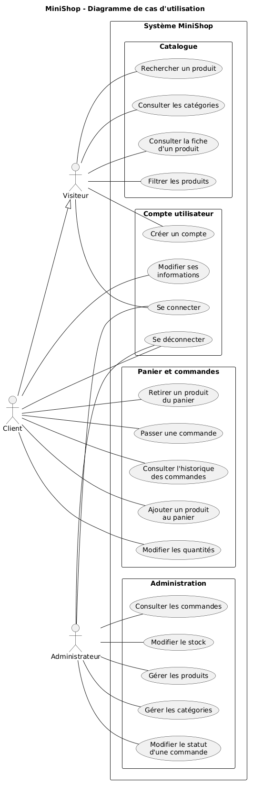
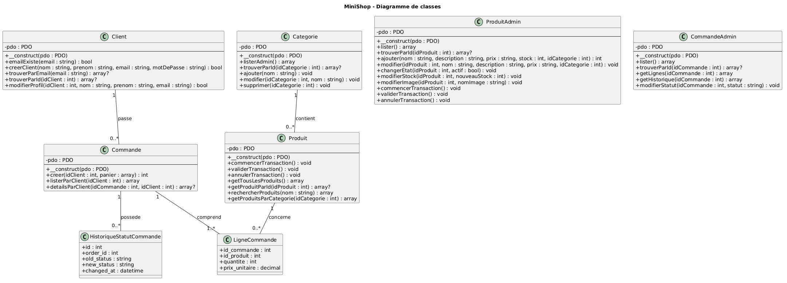
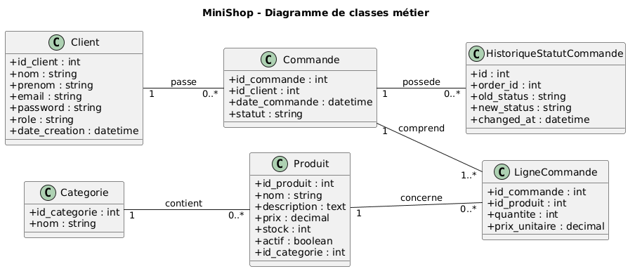
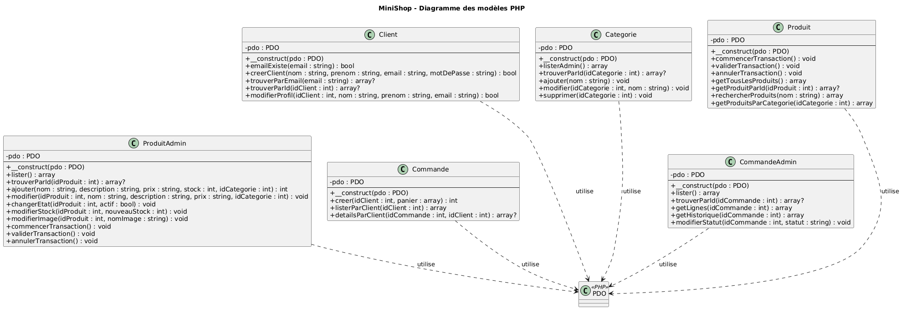
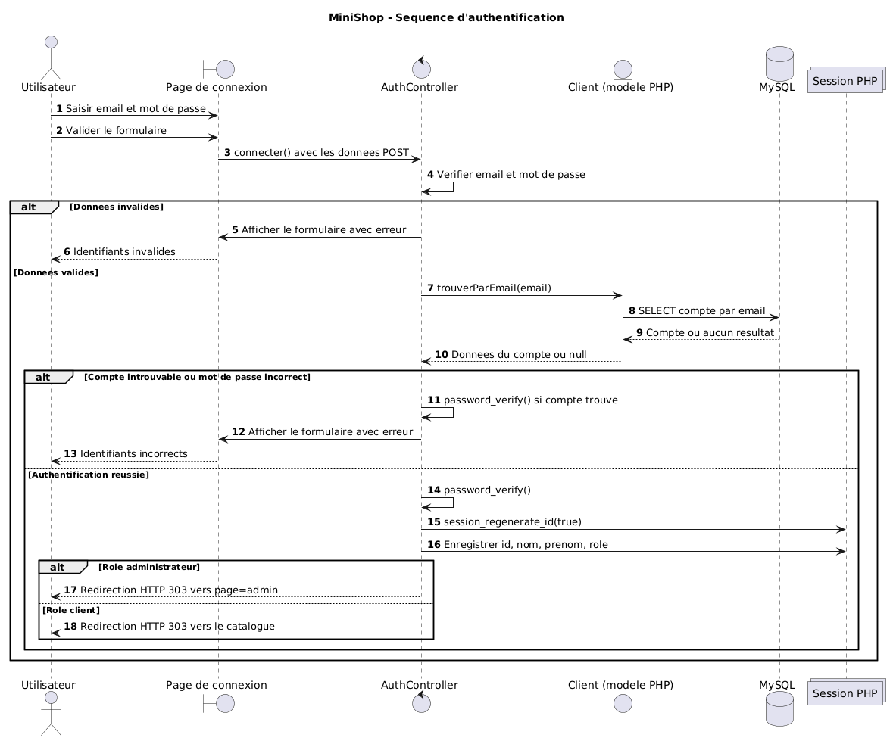
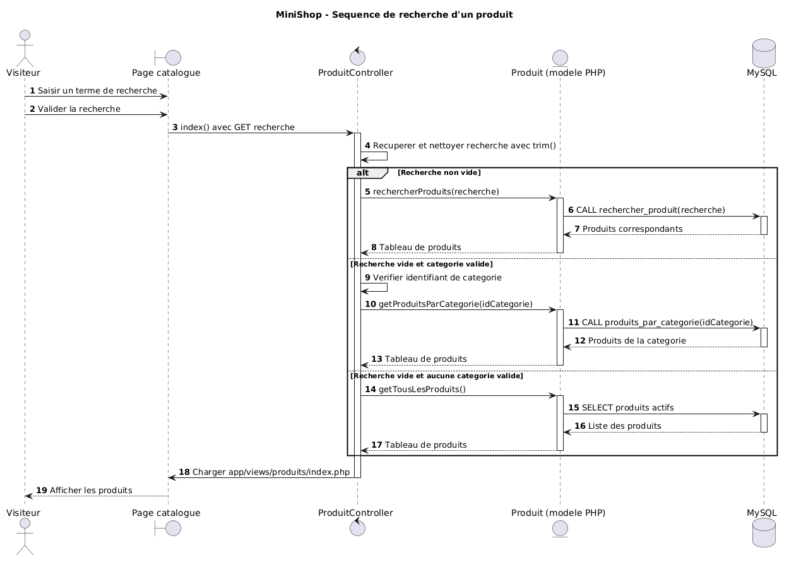
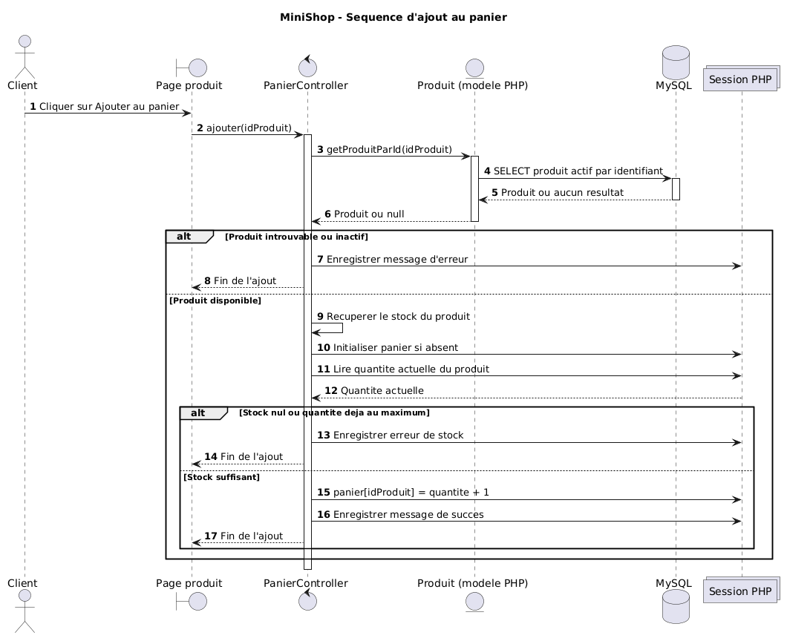
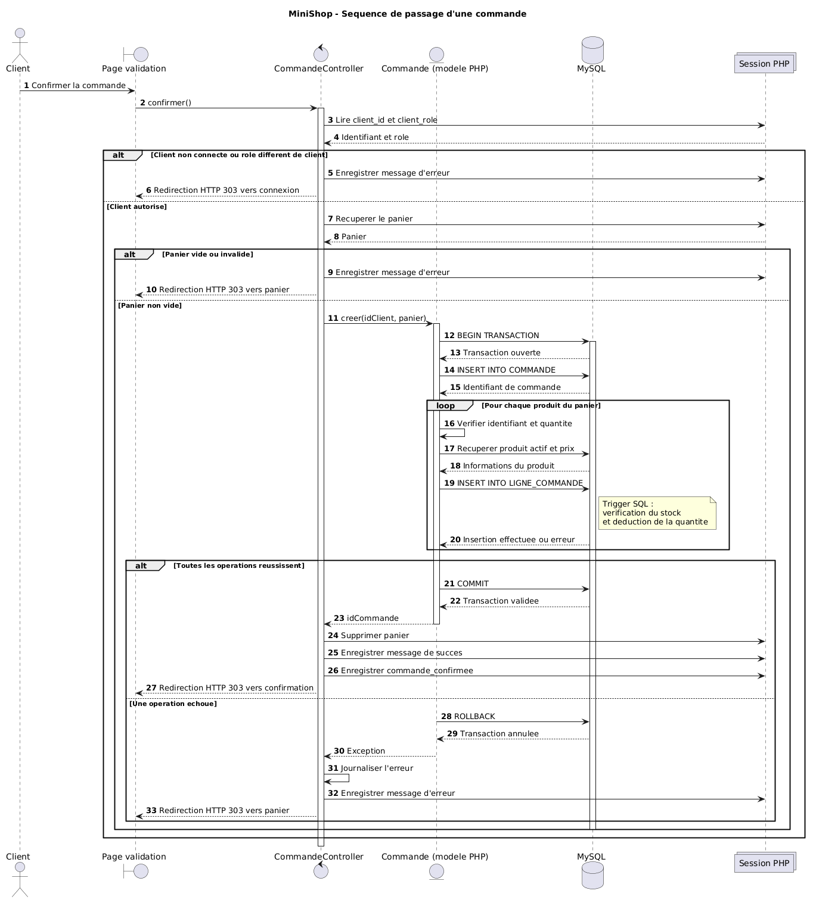

# MiniShop — Document de spécification du système

## 1. Présentation du projet

MiniShop est une application Web de commerce électronique développée dans le cadre d'une SAE de BUT Informatique.

L'application permet de consulter un catalogue de produits technologiques, de rechercher des articles, de filtrer les produits par catégorie et de consulter leurs fiches détaillées.

Les utilisateurs peuvent créer un compte client afin d'accéder à des fonctionnalités supplémentaires, notamment la gestion de leur profil, du panier et des commandes.

Un espace d'administration permet également de gérer les produits, les catégories, les stocks et le suivi des commandes.

MiniShop repose sur une architecture **MVC (Modèle-Vue-Contrôleur)** utilisant principalement PHP orienté objet, MySQL, PDO, HTML, CSS et JavaScript.

Le projet intègre des procédures stockées, des déclencheurs SQL (triggers), des contraintes d'intégrité et des mécanismes de sécurité pour protéger les données et garantir le respect des règles métier.

## 2. Objectifs

### 2.1. Objectif général

L'objectif principal est de concevoir et de développer une application Web de commerce électronique fonctionnelle, sécurisée et maintenable, permettant de gérer un catalogue de produits et le cycle de vie des commandes.

### 2.2. Objectifs fonctionnels

Le système doit permettre :

- Aux visiteurs de consulter les produits, de rechercher des articles et de créer un compte.
- Aux clients de s'authentifier, de gérer leur profil et leur panier, de passer des commandes et de consulter leur historique.
- Aux administrateurs de gérer les catégories, les produits, les stocks et les statuts des commandes.

### 2.3. Objectifs techniques et pédagogiques

Le projet permet de mettre en pratique les compétences suivantes :

- Concevoir et exploiter une base de données relationnelle MySQL.
- Définir des clés primaires, des clés étrangères et des contraintes d'intégrité.
- Développer une application PHP orientée objet.
- Accéder aux données avec PDO et des requêtes préparées.
- Utiliser des procédures stockées et des triggers SQL.
- Organiser une application selon une architecture MVC.
- Développer des interfaces avec HTML, CSS et JavaScript.
- Gérer l'authentification, les sessions et les autorisations.
- Appliquer les bonnes pratiques de sécurité Web.
- Modéliser le système avec des diagrammes UML.
- Tester les fonctionnalités et les règles métier.
- Utiliser Git et GitLab pour le suivi du développement.

## 3. Acteurs du système

MiniShop distingue trois acteurs principaux : le visiteur, le client et l'administrateur.

### 3.1. Visiteur

Le visiteur est un utilisateur qui consulte l'application sans être authentifié.

Il peut :

- Consulter le catalogue de produits.
- Consulter les catégories.
- Rechercher un produit par son nom.
- Filtrer les produits par catégorie.
- Consulter la fiche détaillée d'un produit.
- Créer un compte client.
- Accéder à la page de connexion.

### 3.2. Client

Le client est un utilisateur possédant un compte MiniShop.

Il bénéficie également des fonctionnalités de consultation accessibles au visiteur.

Il peut :

- Se connecter et se déconnecter.
- Consulter son profil.
- Modifier son nom, son prénom et son adresse e-mail.
- Ajouter des produits au panier.
- Consulter le contenu du panier.
- Augmenter ou diminuer les quantités.
- Supprimer des produits du panier.
- Valider une commande.
- Consulter l'historique de ses commandes.
- Consulter le détail de ses commandes.

Chaque client doit accéder uniquement aux commandes associées à son compte.

### 3.3. Administrateur

L'administrateur est un utilisateur disposant du rôle `admin`.

Il peut :

- Se connecter à l'application.
- Accéder à l'espace d'administration.
- Ajouter, modifier et supprimer des catégories lorsque les contraintes le permettent.
- Ajouter et modifier des produits.
- Activer ou désactiver des produits.
- Modifier les stocks.
- Associer ou modifier l'image d'un produit.
- Consulter les commandes des clients.
- Consulter les lignes d'une commande.
- Consulter l'historique des changements de statut.
- Modifier le statut d'une commande selon les transitions autorisées.

Les opérations administratives doivent être protégées par des contrôles d'authentification et d'autorisation.

## 4. Fonctionnalités du système

### 4.1. Consultation du catalogue

Le système permet aux visiteurs et aux clients de :

- Afficher les produits actifs.
- Consulter leur nom, leur description et leur prix.
- Consulter les images des produits.
- Rechercher un produit par son nom.
- Filtrer les produits selon leur catégorie.
- Consulter une fiche produit détaillée.

Les produits désactivés ne doivent pas apparaître dans le catalogue public.

### 4.2. Inscription et authentification

Un visiteur peut créer un compte en renseignant :

- Son nom.
- Son prénom.
- Son adresse e-mail.
- Son mot de passe.
- La confirmation de son mot de passe.

Le système doit :

- Vérifier les champs obligatoires.
- Contrôler le format de l'adresse e-mail.
- Refuser une adresse e-mail déjà utilisée.
- Vérifier la confirmation du mot de passe.
- Appliquer les exigences de sécurité définies pour les mots de passe.
- Hacher le mot de passe avant son enregistrement.

Lors de la connexion, les identifiants sont vérifiés et une session authentifiée est créée.

L'utilisateur peut ensuite se déconnecter.

### 4.3. Gestion du profil client

Un client connecté peut consulter et modifier :

- Son nom.
- Son prénom.
- Son adresse e-mail.

Le système doit vérifier l'authentification du client et utiliser son identifiant de session pour effectuer les modifications.

Un client ne doit pas pouvoir modifier le profil d'un autre utilisateur.

### 4.4. Gestion du panier

Le système permet au client de :

- Ajouter un produit au panier.
- Consulter les produits sélectionnés.
- Augmenter ou diminuer les quantités.
- Supprimer un produit.
- Consulter les prix et le montant total.

Les quantités doivent être valides et respecter les stocks disponibles.

L'ajout d'un produit au panier ne diminue pas immédiatement le stock dans MySQL.

### 4.5. Validation d'une commande

Un client authentifié peut valider son panier.

Le traitement comprend :

1. La vérification de l'identité du client.
2. La vérification que le panier n'est pas vide.
3. La validation des identifiants de produits et des quantités.
4. La récupération des prix depuis MySQL.
5. L'enregistrement de la commande.
6. L'enregistrement des lignes de commande.
7. La vérification et la déduction du stock par le mécanisme SQL prévu.
8. La validation de la transaction.
9. L'affichage de la confirmation de commande.

La méthode `Commande::creer()` utilise une transaction PDO.

Si une opération échoue, les insertions sont annulées afin d'éviter une commande partiellement enregistrée.

Le prix enregistré dans chaque ligne de commande correspond au prix du produit au moment de l'achat.

### 4.6. Historique des commandes

Le client peut consulter ses commandes précédentes.

Pour chaque commande, le système présente notamment :

- L'identifiant de la commande.
- La date de création.
- Le statut.
- Le montant total.

Le client peut également consulter les lignes d'une commande, les quantités, les prix unitaires et les sous-totaux.

Le système vérifie que la commande consultée appartient au client authentifié.

### 4.7. Gestion des catégories

L'administrateur peut :

- Consulter la liste des catégories.
- Ajouter une catégorie.
- Modifier le nom d'une catégorie.
- Supprimer une catégorie lorsque les contraintes de la base de données l'autorisent.

Le nom d'une catégorie doit être unique.

### 4.8. Gestion des produits et des stocks

L'administrateur peut :

- Consulter tous les produits, actifs ou désactivés.
- Ajouter un produit.
- Modifier les informations d'un produit.
- Choisir sa catégorie.
- Activer ou désactiver un produit.
- Modifier son stock.
- Modifier son image.

Le prix d'un produit doit être strictement positif.

Le stock d'un produit ne peut jamais être négatif.

La désactivation permet de retirer un produit du catalogue public sans supprimer nécessairement les informations liées aux anciennes commandes.

### 4.9. Gestion administrative des commandes

L'administrateur peut :

- Consulter toutes les commandes.
- Consulter les informations du client associé à une commande.
- Consulter les lignes d'une commande.
- Consulter l'historique des changements de statut.
- Modifier le statut d'une commande lorsque la transition est autorisée.

Les statuts prévus dans la base de données sont :

- `en_attente`
- `en_preparation`
- `expediee`
- `livree`
- `annulee`

Les transitions entre statuts sont contrôlées par les règles métier du système.

La table `ORDER_STATUS_HISTORY` permet de conserver une trace des changements de statut.

### 4.10. Annulation des commandes

Le statut `annulee` est prévu dans la base de données.

L'annulation doit respecter les transitions autorisées : une commande terminée ne doit pas pouvoir être modifiée librement.

Les modalités exactes d'annulation par le client doivent être distinguées des changements de statut réalisés par l'administrateur. Elles ne sont pas considérées comme confirmées sans vérification du contrôleur correspondant.


## 5. Les diagrammes UML

La modélisation UML permet de représenter le fonctionnement de MiniShop, les interactions entre les utilisateurs et le système, ainsi que l'organisation des données et des classes PHP.

Trois types de diagrammes sont prévus :

- Le diagramme de cas d'utilisation.
- Le diagramme de classes.
- Les diagrammes de séquence.

Les diagrammes sont réalisés avec PlantUML. Les fichiers sources `.puml` et leurs exports `.png` sont conservés dans le dossier `docs/uml/`.

### 5.1. Diagramme de cas d'utilisation

#### 5.1.1. Présentation

Le diagramme de cas d'utilisation représente les fonctionnalités proposées par MiniShop et les interactions avec les trois acteurs principaux :

- **Visiteur** : consulte le catalogue, recherche des produits et peut créer un compte.
- **Client** : bénéficie des fonctionnalités de consultation et peut gérer son profil, son panier et ses commandes.
- **Administrateur** : gère les catégories, les produits, les stocks et les commandes.

Le client possède les fonctionnalités générales du visiteur. Cette relation est représentée par une généralisation entre les deux acteurs.

L'administrateur dispose de fonctionnalités spécifiques, accessibles après authentification.

#### 5.1.2. Diagramme



Source PlantUML : `uml/cas-utilisation.puml`

#### 5.1.3. Principaux cas d'utilisation

Les cas d'utilisation identifiés sont les suivants :

| Acteur | Cas d'utilisation |
|---|---|
| Visiteur | Consulter le catalogue |
| Visiteur | Consulter les catégories |
| Visiteur | Rechercher un produit |
| Visiteur | Filtrer les produits |
| Visiteur | Consulter une fiche produit |
| Visiteur | Créer un compte |
| Visiteur | Se connecter |
| Client | Se déconnecter |
| Client | Consulter et modifier son profil |
| Client | Ajouter un produit au panier |
| Client | Modifier les quantités |
| Client | Supprimer un produit du panier |
| Client | Passer une commande |
| Client | Consulter l'historique des commandes |
| Client | Consulter le détail d'une commande |
| Administrateur | Gérer les catégories |
| Administrateur | Gérer les produits |
| Administrateur | Modifier les stocks |
| Administrateur | Consulter les commandes |
| Administrateur | Modifier le statut d'une commande |

Le statut `annulee` existe également dans le système. L'annulation par un client constitue un cas d'utilisation à distinguer des changements de statut administratifs, selon les fonctionnalités effectivement disponibles dans l'application.

### 5.2. Descriptions textuelles de trois cas d'utilisation

Trois cas d'utilisation sont détaillés afin de préciser leurs acteurs, leurs préconditions, leurs scénarios nominaux, leurs scénarios alternatifs et leurs postconditions.

Les cas choisis sont différents de l'exemple « Passer une commande » fourni dans les consignes.

#### 5.2.1. Cas d'utilisation n°1 : Créer un compte

**Acteur principal :** Visiteur.

**Objectif :** Permettre à un visiteur de créer un compte client pour accéder aux fonctionnalités réservées aux utilisateurs authentifiés.

**Préconditions :**

- Le visiteur peut accéder à la page d'inscription.
- Le serveur Web et la base de données sont disponibles.

**Scénario nominal :**

1. Le visiteur ouvre la page d'inscription.
2. Le système affiche le formulaire de création de compte.
3. Le visiteur renseigne son nom, son prénom, son adresse e-mail et son mot de passe.
4. Le visiteur confirme son mot de passe.
5. Il valide le formulaire.
6. Le système vérifie les champs obligatoires et la validité des informations.
7. Le système vérifie que l'adresse e-mail n'est pas déjà utilisée.
8. Le système hache le mot de passe avec `password_hash()`.
9. Le système enregistre le nouveau compte dans la table `CLIENT`.
10. Le système confirme la création du compte.
11. Le visiteur peut ensuite se connecter.

**Scénarios alternatifs :**

- **A1 — Adresse e-mail déjà utilisée :** le système refuse l'inscription et affiche un message d'erreur.
- **A2 — Champ obligatoire manquant :** le système demande de compléter le formulaire.
- **A3 — Adresse e-mail invalide :** le système demande une adresse valide.
- **A4 — Confirmation du mot de passe incorrecte :** le système signale que les mots de passe ne correspondent pas.
- **A5 — Mot de passe non conforme :** le système refuse l'inscription selon les règles de validation définies.

**Erreurs possibles :**

- La connexion à MySQL échoue.
- L'insertion du compte dans la base de données échoue.

**Postconditions :**

- Un nouveau compte est enregistré dans `CLIENT`.
- Son rôle est `client`.
- Son adresse e-mail est unique.
- Son mot de passe est enregistré sous forme hachée.

#### 5.2.2. Cas d'utilisation n°2 : Gérer le panier

**Acteur principal :** Client.

**Objectif :** Permettre au client de sélectionner des produits et de préparer une commande.

**Préconditions :**

- Le client dispose d'un accès aux fonctionnalités de panier.
- Le catalogue de produits est disponible.
- Le produit sélectionné existe et est actif.

**Scénario nominal :**

1. Le client consulte le catalogue.
2. Il sélectionne un produit.
3. Il demande l'ajout du produit au panier.
4. Le système vérifie le produit et les conditions de disponibilité.
5. Le système ajoute le produit au panier.
6. Le client consulte son panier.
7. Le système affiche les produits, les quantités et les prix.
8. Le client modifie la quantité d'un produit.
9. Le système vérifie la validité de la nouvelle quantité.
10. Le panier est actualisé.
11. Le système affiche le nouveau montant total.

**Scénarios alternatifs :**

- **A1 — Produit indisponible :** l'ajout est refusé.
- **A2 — Stock insuffisant :** le système empêche de sélectionner une quantité supérieure au stock disponible.
- **A3 — Suppression d'un produit :** le client retire un article du panier.
- **A4 — Quantité diminuée jusqu'à zéro :** le produit est retiré du panier selon le comportement de l'interface.
- **A5 — Panier vide :** le système indique qu'aucun produit n'est sélectionné et empêche la validation d'une commande vide.

**Erreurs possibles :**

- Le produit n'existe plus.
- La quantité transmise est invalide.
- Le produit a été désactivé.

**Postconditions :**

- Le panier reflète les choix du client.
- Les quantités et le montant total sont actualisés.
- Le stock MySQL n'est pas diminué par le simple ajout au panier.

#### 5.2.3. Cas d'utilisation n°3 : Gérer les produits

**Acteur principal :** Administrateur.

**Objectif :** Permettre à l'administrateur de gérer les informations et la disponibilité des produits du catalogue.

**Préconditions :**

- L'administrateur est authentifié.
- Son compte possède le rôle `admin`.
- La base de données est accessible.

**Scénario nominal : ajout d'un produit**

1. L'administrateur accède à l'espace d'administration.
2. Le système vérifie ses autorisations.
3. L'administrateur ouvre la gestion des produits.
4. Le système affiche la liste des produits.
5. L'administrateur choisit d'ajouter un produit.
6. Le système affiche le formulaire d'ajout.
7. L'administrateur renseigne le nom, la description, le prix, le stock et la catégorie.
8. Il valide le formulaire.
9. Le système vérifie les informations saisies.
10. Le modèle `ProduitAdmin` appelle la procédure stockée `ajouter_produit`.
11. MySQL enregistre le produit et retourne son identifiant.
12. Le système confirme l'ajout du produit.

**Scénarios alternatifs :**

- **A1 — Modification :** l'administrateur sélectionne un produit et modifie ses informations.
- **A2 — Désactivation :** l'administrateur désactive un produit afin qu'il n'apparaisse plus dans le catalogue public.
- **A3 — Modification du stock :** l'administrateur renseigne une nouvelle quantité disponible.
- **A4 — Modification de l'image :** l'administrateur associe ou remplace l'image d'un produit.
- **A5 — Prix invalide :** le système refuse un prix inférieur ou égal à zéro.
- **A6 — Stock invalide :** le système refuse un stock négatif.
- **A7 — Catégorie inexistante :** l'enregistrement est refusé en raison des contraintes de la base de données.

**Erreurs possibles :**

- L'utilisateur ne possède pas les droits d'administration.
- Une procédure stockée échoue.
- Une contrainte d'intégrité MySQL n'est pas respectée.

**Postconditions :**

- Le produit est enregistré ou modifié selon l'action effectuée.
- Le catalogue public reflète l'état actif ou désactivé du produit.
- Les contraintes sur le prix, le stock et la catégorie sont respectées.

### 5.3. Diagrammes de classes

#### 5.3.1. Présentation générale

Le diagramme de classes permet d'identifier les principales classes du système, leurs attributs, leurs méthodes et leurs relations.

MiniShop utilise une architecture MVC dans laquelle les classes PHP du dossier `app/models/` servent principalement à accéder aux données MySQL.

Les classes PHP ne correspondent donc pas exactement aux entités métier représentées par les tables de la base de données.

Pour distinguer clairement ces deux niveaux, la modélisation comprend trois vues complémentaires :

1. Un diagramme global, présentant les principaux modèles PHP et certaines relations métier.
2. Un diagramme de classes métier, présentant les entités SQL, leurs attributs, leurs associations et leurs cardinalités.
3. Un diagramme des modèles PHP, présentant les classes réellement implémentées, leurs méthodes et leurs dépendances.

Cette séparation permet de représenter le fonctionnement métier sans attribuer artificiellement aux classes PHP des propriétés ou des relations qu'elles ne possèdent pas.

#### 5.3.2. Diagramme global



Source PlantUML : `uml/diagramme-classes.puml`

Ce diagramme présente une vue synthétique du système.

Il rassemble les principales classes PHP utilisées pour la gestion des clients, des produits, des catégories et des commandes, ainsi que des entités nécessaires à la représentation des relations métier.

Il est conservé comme vue complémentaire. Les deux diagrammes suivants constituent les références principales pour l'analyse détaillée.

#### 5.3.3. Diagramme de classes métier



Source PlantUML : `uml/diagramme-classes-metier.puml`

Ce diagramme est construit à partir des fichiers SQL `schema.sql` et `schema_admin.sql`.

Il présente les six entités métier suivantes :

| Entité | Rôle |
|---|---|
| `Client` | Représente les comptes clients et administrateurs |
| `Categorie` | Regroupe les produits du catalogue |
| `Produit` | Représente les articles proposés à la vente |
| `Commande` | Représente une commande passée par un client |
| `LigneCommande` | Représente un produit et sa quantité dans une commande |
| `HistoriqueStatutCommande` | Conserve les changements de statut d'une commande |

**Attributs principaux :**

**Client**

- `id_client : int`
- `nom : string`
- `prenom : string`
- `email : string`
- `password : string`
- `role : string`
- `date_creation : datetime`

**Categorie**

- `id_categorie : int`
- `nom : string`

**Produit**

- `id_produit : int`
- `nom : string`
- `description : text`
- `prix : decimal`
- `stock : int`
- `actif : boolean`
- `id_categorie : int`
- `image : string`

**Commande**

- `id_commande : int`
- `id_client : int`
- `date_commande : datetime`
- `statut : string`

**LigneCommande**

- `id_commande : int`
- `id_produit : int`
- `quantite : int`
- `prix_unitaire : decimal`

**HistoriqueStatutCommande**

- `id : int`
- `order_id : int`
- `old_status : string`
- `new_status : string`
- `changed_at : datetime`

#### 5.3.4. Associations et cardinalités

Les associations sont déterminées à partir des clés étrangères de la base de données et des règles métier de MiniShop.

| Association | Cardinalité | Justification |
|---|---|---|
| Client — Commande | `1` à `0..*` | Chaque commande appartient à un client ; un client peut avoir plusieurs commandes |
| Categorie — Produit | `1` à `0..*` | Chaque produit appartient à une catégorie ; une catégorie peut contenir plusieurs produits |
| Commande — LigneCommande | `1` à `1..*` | Une commande validée doit contenir au moins une ligne |
| Produit — LigneCommande | `1` à `0..*` | Chaque ligne correspond à un produit ; un produit peut apparaître dans plusieurs commandes |
| Commande — HistoriqueStatutCommande | `1` à `0..*` | Chaque changement de statut concerne une commande ; une commande peut avoir plusieurs changements |

**Justification de l'association Client — Commande**

La table `COMMANDE` possède la clé étrangère `id_client`, qui référence `CLIENT(id_client)`.

Cette contrainte garantit qu'une commande enregistrée est associée à un seul client existant.

**Justification de l'association Categorie — Produit**

La table `PRODUIT` possède la clé étrangère `id_categorie`, qui référence `CATEGORIE(id_categorie)`.

Un produit ne peut donc appartenir qu'à une seule catégorie à un instant donné.

**Justification de l'entité LigneCommande**

Une commande peut contenir plusieurs produits et un produit peut apparaître dans plusieurs commandes.

Cette relation plusieurs-à-plusieurs est représentée par la table intermédiaire `LIGNE_COMMANDE`.

Elle contient les attributs `quantite` et `prix_unitaire`, nécessaires pour conserver les informations propres à chaque achat.

La clé primaire composée `(id_commande, id_produit)` empêche qu'un même produit apparaisse plusieurs fois dans une même commande sous des lignes distinctes.

La cardinalité minimale `1..*` entre une commande validée et ses lignes représente une règle métier appliquée par le traitement PHP de création de commande. Elle n'est pas garantie par la seule clé étrangère SQL.

**Justification de l'historique des statuts**

La table `ORDER_STATUS_HISTORY` permet de conserver l'ancien statut, le nouveau statut et la date d'un changement.

Elle est liée à la table `COMMANDE` par la clé étrangère `order_id`.

Cette organisation améliore la traçabilité des opérations administratives.

#### 5.3.5. Diagramme des modèles PHP



Source PlantUML : `uml/diagramme-modeles-php.puml`

Ce diagramme représente les six classes réellement présentes dans le dossier `app/models/` :

- `Client`
- `Categorie`
- `Produit`
- `ProduitAdmin`
- `Commande`
- `CommandeAdmin`

Chaque classe possède un attribut privé :

`- pdo : PDO`

Cet attribut permet d'accéder à la base de données MySQL.

Les dépendances pointillées vers `PDO` indiquent que les modèles utilisent cette classe fournie par PHP.

Les classes `ProduitAdmin` et `CommandeAdmin` ne possèdent pas de relation d'héritage avec `Produit` et `Commande`.

Elles sont séparées afin de distinguer les opérations d'administration des fonctionnalités destinées aux clients.

#### 5.3.6. Méthodes principales des modèles PHP

**Classe `Client`**

- `emailExiste()` : vérifie si une adresse e-mail est déjà utilisée.
- `creerClient()` : crée un compte client.
- `trouverParEmail()` : recherche un compte à partir de son e-mail.
- `trouverParId()` : récupère les informations d'un client.
- `modifierProfil()` : modifie les informations du profil.

**Classe `Categorie`**

- `listerAdmin()` : liste les catégories pour l'administration.
- `trouverParId()` : recherche une catégorie.
- `ajouter()` : ajoute une catégorie.
- `modifier()` : modifie une catégorie.
- `supprimer()` : supprime une catégorie.

**Classe `Produit`**

- `getTousLesProduits()` : récupère les produits actifs.
- `getProduitParId()` : récupère un produit actif.
- `rechercherProduits()` : recherche des produits par leur nom.
- `getProduitsParCategorie()` : filtre les produits par catégorie.
- `commencerTransaction()` : démarre une transaction.
- `validerTransaction()` : valide une transaction.
- `annulerTransaction()` : annule une transaction.

**Classe `ProduitAdmin`**

- `lister()` : récupère tous les produits.
- `trouverParId()` : recherche un produit, même désactivé.
- `ajouter()` : ajoute un produit.
- `modifier()` : modifie un produit.
- `changerEtat()` : active ou désactive un produit.
- `modifierStock()` : modifie son stock.
- `modifierImage()` : modifie son image.
- `commencerTransaction()` : démarre une transaction.
- `validerTransaction()` : valide une transaction.
- `annulerTransaction()` : annule une transaction.

**Classe `Commande`**

- `creer()` : enregistre une commande et ses lignes.
- `listerParClient()` : récupère les commandes d'un client.
- `detailsParClient()` : récupère les détails d'une commande appartenant à un client.

**Classe `CommandeAdmin`**

- `lister()` : liste toutes les commandes.
- `trouverParId()` : recherche une commande avec les informations du client.
- `getLignes()` : récupère les lignes d'une commande.
- `getHistorique()` : consulte l'historique des changements de statut.
- `modifierStatut()` : modifie le statut d'une commande.

Toutes les classes possèdent également un constructeur recevant une connexion `PDO`.

#### 5.3.7. Justification des choix de conception

**Séparation entre les entités métier et les modèles PHP**

Les entités métier représentent les données et leurs relations.

Les modèles PHP regroupent les méthodes permettant de lire ou de modifier ces données.

Cette séparation évite de confondre la structure relationnelle MySQL avec l'implémentation PHP.

**Séparation entre les opérations client et administrateur**

Les classes `Produit` et `Commande` proposent les fonctionnalités nécessaires à la consultation du catalogue et à la gestion des commandes clients.

Les classes `ProduitAdmin` et `CommandeAdmin` regroupent les opérations d'administration.

Cette organisation améliore la lisibilité du code et facilite la répartition des responsabilités.

**Utilisation de PDO**

Les modèles utilisent PDO pour communiquer avec MySQL.

Les requêtes préparées permettent de transmettre les paramètres séparément du code SQL.

**Utilisation des procédures stockées**

Certaines opérations sont centralisées dans MySQL, notamment :

- `rechercher_produit`
- `produits_par_categorie`
- `ajouter_produit`
- `modifier_produit`
- `modifier_stock`
- `modifier_statut_commande`

Cette organisation permet de réutiliser des traitements SQL depuis les modèles PHP.

**Utilisation des transactions**

La création d'une commande utilise une transaction afin de garantir la cohérence des opérations.

En cas d'erreur pendant l'enregistrement d'une ligne, les insertions de la commande sont annulées.

**Conservation des prix d'achat**

Le prix unitaire est enregistré dans `LIGNE_COMMANDE`.

Ainsi, une modification ultérieure du prix d'un produit dans le catalogue ne modifie pas le prix enregistré dans une ancienne commande.

### 5.4. Diagrammes de séquence


Conformément aux consignes du projet, au moins quatre diagrammes de séquence doivent être réalisés.

Ils représenteront les interactions entre les acteurs, les contrôleurs, les modèles PHP et la base de données MySQL.

Les procédures stockées et les triggers seront intégrés lorsqu'ils interviennent dans le scénario.

#### 5.4.1. Séquence n°1 : Authentification




Source PlantUML : `uml/sequence-authentification.puml`

Cette séquence représente :

1. La saisie des identifiants.
2. L'envoi du formulaire de connexion.
3. La vérification des informations.
4. La recherche du compte par son adresse e-mail.
5. La vérification du mot de passe avec `password_verify()`.
6. La création de la session.
7. La redirection vers l'espace approprié.

#### 5.4.2. Séquence n°2 : Recherche d'un produit



Source PlantUML : `uml/sequence-recherche-produit.puml`

Cette séquence représente :

1. La saisie d'un terme de recherche.
2. L'envoi de la demande au serveur.
3. L'appel du contrôleur concerné.
4. L'appel de `Produit::rechercherProduits()`.
5. L'exécution de la procédure stockée `rechercher_produit`.
6. La récupération des résultats.
7. L'affichage des produits correspondants.

#### 5.4.3. Séquence n°3 : Ajout au panier



Source PlantUML : `uml/sequence-ajout-panier.puml`

Cette séquence représente :

1. La sélection d'un produit.
2. La demande d'ajout au panier.
3. La vérification de la requête et des autorisations nécessaires.
4. La vérification de l'existence et de la disponibilité du produit.
5. La vérification de la quantité.
6. La mise à jour du panier.
7. L'affichage du panier actualisé.

Le détail des participants et des mécanismes de sécurité sera confirmé à partir du contrôleur PHP correspondant.

#### 5.4.4. Séquence n°4 : Passer une commande



Source PlantUML : `uml/sequence-passer-commande.puml`

Cette séquence représente :

1. La demande de validation du panier.
2. La vérification de l'authentification.
3. La vérification que le panier n'est pas vide.
4. L'appel de `Commande::creer()`.
5. Le démarrage d'une transaction PDO.
6. L'insertion dans la table `COMMANDE`.
7. La vérification des produits et des quantités.
8. La récupération des prix depuis MySQL.
9. L'insertion des lignes dans `LIGNE_COMMANDE`.
10. L'intervention du trigger SQL de contrôle et de déduction du stock.
11. La validation de la transaction si toutes les opérations réussissent.
12. L'annulation de la transaction en cas d'erreur.
13. L'affichage de la confirmation ou d'un message d'erreur.

Cette séquence est particulièrement importante, car elle permet d'illustrer l'utilisation conjointe de PHP, PDO, MySQL, des transactions et des triggers.


#### 5.4.5. Séquence n°5 : Ajout d'un produit par l'administrateur


Source PlantUML : `uml/sequence-admin-ajout-produit.puml`

Ce diagramme représente l'ajout d'un produit depuis l'espace d'administration.

Il présente :

- La vérification de l'authentification et du rôle administrateur.
- La validation du nom, de la description, du prix, du stock et de la catégorie.
- L'enregistrement éventuel d'une image.
- L'appel à la procédure stockée `ajouter_produit`.
- L'association de l'image au produit, si nécessaire.
- La validation de la transaction SQL avec `COMMIT`.
- L'annulation des modifications avec `ROLLBACK` en cas d'erreur.
- L'affichage d'un message de succès ou d'erreur.

Ce scénario illustre la collaboration entre `AdminController`, `ProduitAdmin`, `ImageProduitService` et MySQL.


## 6. Règles métier

Les règles métier définissent les contraintes que MiniShop doit respecter pour garantir la cohérence des données et le bon fonctionnement des opérations.

Elles sont appliquées à différents niveaux :

- Dans les formulaires de l'interface utilisateur.
- Dans les contrôleurs et les modèles PHP.
- Dans la base de données MySQL, grâce aux contraintes SQL, aux procédures stockées et aux triggers.

### 6.1. Unicité des adresses e-mail

**RM01 — L'adresse e-mail d'un client doit être unique.**

Deux comptes ne peuvent pas utiliser la même adresse e-mail.

La table `CLIENT` possède une contrainte `UNIQUE` sur la colonne `email`.

La méthode `Client::emailExiste()` permet également de vérifier si une adresse est déjà utilisée avant la création d'un compte.

Cette règle évite les doublons et garantit l'identification des comptes par leur adresse e-mail.

### 6.2. Prix des produits

**RM02 — Le prix d'un produit doit être strictement positif.**

Un produit ne peut pas avoir un prix nul ou négatif.

La table `PRODUIT` contient la contrainte :

```sql
CONSTRAINT chk_produit_prix
    CHECK (prix > 0)
```

Cette vérification protège la cohérence du catalogue.

### 6.3. Gestion des stocks

**RM03 — Le stock d'un produit ne peut jamais être négatif.**

La table `PRODUIT` contient la contrainte :

```sql
CONSTRAINT chk_produit_stock
    CHECK (stock >= 0)
```

Lors de la validation d'une commande, le stock disponible doit être suffisant pour satisfaire les quantités demandées.

Le mécanisme SQL de gestion des commandes intervient pour contrôler et déduire le stock lors de l'enregistrement des lignes.

### 6.4. Contenu d'une commande

**RM04 — Une commande doit contenir au moins une ligne.**

Il est interdit de valider une commande avec un panier vide.

La méthode `Commande::creer()` vérifie cette condition avant de démarrer la transaction.

```php
if ($idClient <= 0 || empty($panier)) {
    throw new InvalidArgumentException(
        "Impossible de créer une commande avec un panier vide."
    );
}
```

La transaction garantit que les insertions déjà réalisées sont annulées si l'enregistrement d'une ligne échoue.

Cette règle est appliquée par le traitement PHP de création de commande. Elle n'est pas imposée à elle seule par la définition SQL de la table `COMMANDE`.

### 6.5. Quantités commandées

**RM05 — La quantité commandée doit être strictement supérieure à zéro.**

Chaque ligne de commande doit contenir une quantité entière positive.

La table `LIGNE_COMMANDE` possède la contrainte :

```sql
CONSTRAINT chk_ligne_quantite
    CHECK (quantite > 0)
```

La méthode `Commande::creer()` vérifie également les quantités avant de les enregistrer.

Une quantité nulle, négative ou invalide entraîne le refus de l'opération.

### 6.6. Conservation des prix au moment de l'achat

**RM06 — Le prix enregistré dans une ligne de commande doit correspondre au prix du produit au moment de l'achat.**

Le prix d'un produit peut évoluer dans le catalogue.

Cependant, une commande passée précédemment doit conserver son prix d'origine.

La table `LIGNE_COMMANDE` possède donc l'attribut :

`prix_unitaire DECIMAL(10,2) NOT NULL`

Lors de la création d'une commande, le modèle `Commande` récupère le prix directement depuis MySQL.

Ce prix est ensuite enregistré dans chaque ligne de commande.

Ainsi, une modification ultérieure du prix du produit ne change pas le montant des commandes précédentes.

### 6.7. Appartenance d'un produit à une catégorie

**RM07 — Un produit appartient à une seule catégorie.**

Chaque produit possède un identifiant `id_categorie`.

La table `PRODUIT` contient une clé étrangère vers `CATEGORIE`.

```sql
CONSTRAINT fk_produit_categorie
    FOREIGN KEY (id_categorie)
    REFERENCES CATEGORIE(id_categorie)
```

La colonne `id_categorie` est obligatoire.

Un produit doit donc être associé à une catégorie existante.

### 6.8. Produits d'une catégorie

**RM08 — Une catégorie peut contenir plusieurs produits.**

Une catégorie peut contenir zéro, un ou plusieurs produits.

Cette relation est représentée dans le diagramme de classes métier par les cardinalités :

- `1` catégorie pour chaque produit.
- `0..*` produits pour chaque catégorie.

### 6.9. Commandes d'un client

**RM09 — Un client peut passer plusieurs commandes.**

Un client peut ne posséder aucune commande ou en posséder plusieurs.

Cette relation est représentée dans le diagramme métier par :

`Client 1 — 0..* Commande`

### 6.10. Propriétaire d'une commande

**RM10 — Chaque commande appartient à un seul client.**

La table `COMMANDE` possède la colonne obligatoire `id_client`.

Cette colonne est une clé étrangère vers `CLIENT(id_client)`.

```sql
CONSTRAINT fk_commande_client
    FOREIGN KEY (id_client)
    REFERENCES CLIENT(id_client)
```

Une commande ne peut donc pas être enregistrée sans référence à un client existant.

### 6.11. Statuts des commandes

**RM11 — Une commande possède un statut défini et les changements doivent respecter les transitions autorisées.**

Les statuts présents dans la base de données sont :

| Statut SQL | Signification |
|---|---|
| `en_attente` | Commande enregistrée et en attente de traitement |
| `en_preparation` | Commande en cours de préparation |
| `expediee` | Commande expédiée |
| `livree` | Commande livrée |
| `annulee` | Commande annulée |

Le statut initial d'une nouvelle commande est `en_attente`.

Le parcours normal d'une commande est :

`en_attente → en_preparation → expediee → livree`

Le statut `annulee` permet de représenter une commande annulée lorsque les règles de transition l'autorisent.

Les commandes livrées ou annulées sont considérées comme terminées dans le fonctionnement observé de l'application.

La méthode `CommandeAdmin::modifierStatut()` appelle la procédure stockée `modifier_statut_commande`.

Les transitions sont également contrôlées par un trigger SQL prévu pour cette opération.

### 6.12. Règles métier complémentaires

**RM12 — Un client ne peut consulter que ses propres commandes.**

La méthode `Commande::detailsParClient()` recherche une commande à partir de son identifiant et de celui du client.

Cette double vérification contribue à empêcher l'accès aux commandes d'un autre utilisateur.

**RM13 — Les fonctionnalités administratives sont réservées aux administrateurs.**

L'utilisateur doit être authentifié et posséder le rôle `admin`.

**RM14 — Un produit désactivé ne doit pas apparaître dans le catalogue public.**

Les méthodes de consultation du modèle `Produit` sélectionnent les produits actifs.

L'administration peut néanmoins consulter les produits désactivés.

**RM15 — L'ajout au panier ne diminue pas immédiatement le stock.**

Le stock est mis à jour lors du traitement de la commande, et non au moment de la simple sélection d'un produit.

**RM16 — Les changements de statut doivent pouvoir être tracés.**

La table `ORDER_STATUS_HISTORY` conserve :

- L'identifiant de la commande.
- L'ancien statut.
- Le nouveau statut.
- La date du changement.

Cette table permet à l'administrateur de consulter l'historique des statuts.

**RM17 — Un client ne peut modifier que son propre profil.**

L'identifiant du compte à modifier doit être déterminé à partir de la session authentifiée, et non d'un identifiant arbitraire transmis par l'utilisateur.

**RM18 — Les mots de passe doivent être conservés sous forme hachée.**

Le modèle `Client` utilise `password_hash()` lors de la création du compte.

Le mot de passe ne doit jamais être enregistré en clair.

---

## 7. Contraintes techniques

### 7.1. Technologies utilisées

MiniShop est développé à l'aide des technologies suivantes :

| Technologie | Utilisation |
|---|---|
| PHP orienté objet | Traitements côté serveur et logique applicative |
| MySQL | Stockage des données |
| PDO | Communication entre PHP et MySQL |
| SQL | Requêtes et contraintes d'intégrité |
| Procédures stockées | Centralisation de certaines opérations sur les données |
| Triggers SQL | Application automatique de certaines règles métier |
| HTML | Structure des pages |
| CSS | Mise en forme des interfaces |
| JavaScript | Interactions côté navigateur |
| PlantUML | Réalisation des diagrammes UML |
| Git | Gestion des versions |
| GitLab | Hébergement du dépôt du projet |

### 7.2. Utilisation de PHP orienté objet

L'application utilise des classes PHP pour organiser l'accès aux données.

Les modèles principaux sont :

- `Client`
- `Categorie`
- `Produit`
- `ProduitAdmin`
- `Commande`
- `CommandeAdmin`

Ces classes regroupent des méthodes correspondant à des responsabilités précises.

Les opérations d'administration sont séparées des fonctionnalités de consultation et de commande destinées aux clients.

### 7.3. Utilisation de PDO

La communication avec MySQL est réalisée à l'aide de PDO.

Les modèles reçoivent une connexion PDO dans leur constructeur.

Exemple :

```php
private PDO $pdo;

public function __construct(PDO $pdo)
{
    $this->pdo = $pdo;
}
```

Les requêtes paramétrées utilisent principalement :

- `PDO::prepare()`
- `PDOStatement::execute()`

Cette approche facilite la maintenance du code et contribue à la protection contre les injections SQL.

### 7.4. Contraintes de la base de données

La base de données comprend six tables identifiées dans les scripts SQL étudiés :

1. `CLIENT`
2. `CATEGORIE`
3. `PRODUIT`
4. `COMMANDE`
5. `LIGNE_COMMANDE`
6. `ORDER_STATUS_HISTORY`

Les cinq premières sont définies dans `schema.sql`.

La table d'historique est définie dans `schema_admin.sql`.

La base de données utilise :

- Des clés primaires.
- Des clés étrangères.
- Des contraintes `NOT NULL`.
- Des contraintes `UNIQUE`.
- Des contraintes `CHECK`.
- Des valeurs par défaut.
- Des types adaptés aux données.

Les clés étrangères assurent notamment la cohérence des relations entre les produits, les catégories, les clients et les commandes.

### 7.5. Procédures stockées

MiniShop utilise plusieurs procédures stockées MySQL.

Parmi celles appelées par les modèles PHP étudiés :

| Procédure | Utilisation |
|---|---|
| `rechercher_produit` | Recherche de produits |
| `produits_par_categorie` | Filtrage par catégorie |
| `lister_categories_admin` | Liste administrative des catégories |
| `ajouter_categorie` | Ajout d'une catégorie |
| `modifier_categorie` | Modification d'une catégorie |
| `supprimer_categorie` | Suppression d'une catégorie |
| `lister_produits_admin` | Liste administrative des produits |
| `ajouter_produit` | Ajout d'un produit |
| `modifier_produit` | Modification d'un produit |
| `changer_etat_produit` | Activation ou désactivation d'un produit |
| `modifier_stock` | Modification du stock |
| `modifier_image_produit` | Modification de l'image |
| `lister_commandes_admin` | Liste administrative des commandes |
| `lignes_commande` | Consultation des lignes d'une commande |
| `historique_statut_commande` | Consultation de l'historique |
| `modifier_statut_commande` | Modification du statut |

Cette liste correspond aux appels présents dans les modèles PHP analysés.

Les définitions SQL de ces procédures doivent être conservées dans les scripts de base de données du projet.

### 7.6. Triggers SQL

Les triggers permettent d'exécuter automatiquement des traitements lors de certaines opérations sur les tables.

Dans MiniShop, ils interviennent notamment dans :

- Le contrôle et la déduction du stock lors de l'enregistrement d'une ligne de commande.
- Le contrôle des transitions de statut des commandes.

L'historique des changements de statut est conservé dans la table `ORDER_STATUS_HISTORY`.

Le fonctionnement exact de chaque trigger doit être vérifié à partir de sa définition SQL.

### 7.7. Transactions

Les opérations de création d'une commande doivent être réalisées dans une transaction.

La méthode `Commande::creer()` utilise :

- `beginTransaction()` pour démarrer la transaction.
- `commit()` pour valider les opérations.
- `rollBack()` pour annuler les opérations en cas d'erreur.

Cette organisation évite qu'une commande soit partiellement enregistrée si une étape échoue.

### 7.8. Environnement et déploiement

L'application est développée et testée dans un environnement PHP/MySQL.

Elle doit également être compatible avec l'environnement d'hébergement fourni par l'IUT.

Le dossier `public/` contient le point d'entrée Web de l'application.

La configuration de connexion à MySQL doit être adaptée à chaque environnement.

Les paramètres locaux de connexion ne doivent pas remplacer ceux du serveur universitaire lors du déploiement.

---

## 8. Sécurité de l'application

La sécurité est essentielle pour protéger les comptes, les données personnelles, les commandes et les fonctionnalités d'administration.

Les mécanismes présentés ci-dessous constituent les exigences de sécurité de MiniShop. Certains sont directement visibles dans les modèles PHP étudiés ; d'autres nécessitent une vérification complémentaire des contrôleurs et des vues.

### 8.1. Protection contre les injections SQL

Une injection SQL consiste à introduire des instructions SQL malveillantes dans des données transmises à l'application.

Pour limiter ce risque, les valeurs provenant des utilisateurs doivent être transmises séparément du texte des requêtes.

MiniShop utilise des requêtes préparées PDO.

Exemple extrait du fonctionnement du modèle `Client` :

```php
$requete = $this->pdo->prepare(
    "SELECT id_client, nom, prenom, email
     FROM CLIENT
     WHERE id_client = :id_client"
);

$requete->execute([
    'id_client' => $idClient
]);
```

Les paramètres ne doivent pas être directement concaténés dans les requêtes SQL.

Les appels aux procédures stockées doivent également utiliser des paramètres correctement transmis.

### 8.2. Protection des mots de passe

Les mots de passe ne doivent jamais être enregistrés en clair.

Lors de la création d'un compte, le modèle `Client` utilise :

```php
password_hash($motDePasse, PASSWORD_DEFAULT);
```

Cette fonction produit un hachage du mot de passe.

Lors de la connexion, la vérification doit être réalisée avec :

```php
password_verify($motDePasse, $hashEnregistre);
```

Le mot de passe ne doit pas être affiché dans les pages de profil ni exposé dans les messages d'erreur.

### 8.3. Protection contre les attaques XSS

Une attaque XSS consiste à faire interpréter par le navigateur du code injecté dans une page Web.

Les données provenant des utilisateurs ou de la base de données doivent être échappées avant leur affichage dans le HTML.

Pour les contenus textuels et les attributs HTML adaptés, PHP propose :

```php
htmlspecialchars($valeur, ENT_QUOTES, 'UTF-8');
```

Cette fonction transforme les caractères spéciaux afin qu'ils ne soient pas interprétés comme du code HTML.

Les vues doivent appliquer un échappement adapté au contexte d'affichage.

### 8.4. Gestion des sessions

Les sessions PHP permettent de conserver l'état d'authentification d'un utilisateur entre plusieurs requêtes.

MiniShop utilise notamment les informations de session suivantes :

- `$_SESSION['client_id']`
- `$_SESSION['client_nom']`
- `$_SESSION['client_prenom']`
- `$_SESSION['client_role']`

Les pages privées doivent vérifier qu'un utilisateur est authentifié avant d'autoriser l'accès.

Lors de la connexion, il est recommandé de renouveler l'identifiant de session avec :

```php
session_regenerate_id(true);
```

La déconnexion doit supprimer les informations d'authentification de la session.

### 8.5. Protection contre les attaques CSRF

Une attaque CSRF consiste à amener un navigateur authentifié à envoyer une requête non souhaitée.

Les formulaires qui modifient des données doivent être protégés par un jeton CSRF.

Le jeton peut être enregistré dans la session :

```php
$_SESSION['csrf_token']
```

Il est ensuite transmis avec le formulaire et vérifié côté serveur.

Une requête présentant un jeton invalide doit être refusée.

La présence et la validation effective de cette protection doivent être vérifiées dans les contrôleurs concernés.

### 8.6. Authentification et autorisation

L'authentification permet de vérifier l'identité d'un utilisateur.

L'autorisation permet de vérifier qu'il possède le droit d'effectuer une action.

Ces deux notions sont distinctes.

**Pour un client :**

- L'utilisateur doit être connecté.
- Les données consultées doivent lui appartenir.
- Les opérations doivent respecter les règles métier.

**Pour un administrateur :**

- L'utilisateur doit être authentifié.
- Son rôle doit être `admin`.
- Les opérations doivent être réservées à l'espace d'administration.

Ces vérifications doivent être réalisées côté serveur et ne doivent pas reposer uniquement sur l'affichage ou le masquage de boutons.

### 8.7. Protection des commandes des clients

Un client ne doit pas pouvoir accéder aux commandes d'un autre client en modifiant un identifiant dans l'URL.

Par exemple, modifier :

```text
index.php?page=commande&id=25
```

ne doit pas permettre de consulter une commande appartenant à un autre utilisateur.

La méthode `Commande::detailsParClient()` contribue à cette protection en recherchant la commande avec deux conditions :

```sql
WHERE c.id_commande = :id_commande
  AND c.id_client = :id_client
```

Si la commande n'existe pas ou n'appartient pas au client, la méthode retourne `null`.

L'identifiant du client doit provenir de la session authentifiée.

### 8.8. Validation des données

Les informations provenant des formulaires doivent être vérifiées côté serveur.

Les contrôles concernent notamment :

- Les champs obligatoires.
- Le format des adresses e-mail.
- Les identifiants numériques.
- Les prix strictement positifs.
- Les stocks non négatifs.
- Les quantités commandées positives.
- Les rôles et les autorisations.

Les contraintes MySQL constituent une protection supplémentaire lorsque les contrôles applicatifs sont insuffisants.

### 8.9. Gestion des erreurs

Les messages d'erreur affichés aux utilisateurs ne doivent pas révéler :

- Les identifiants de connexion à la base de données.
- Les requêtes SQL internes.
- Les chemins sensibles du serveur.
- Les informations confidentielles des autres utilisateurs.

Les erreurs techniques doivent être traitées côté serveur.

Les utilisateurs doivent recevoir des messages compréhensibles et adaptés à la situation.

### 8.10. Vérification de la sécurité

Les tests fonctionnels réalisés sur MiniShop ont permis de vérifier plusieurs comportements, notamment :

- Le refus d'une adresse e-mail déjà utilisée.
- L'impossibilité de valider un panier vide.
- Le refus des quantités invalides.
- La conservation des prix dans les commandes précédentes.
- La séparation des commandes entre comptes clients.
- Le respect des transitions de statut observées dans l'interface.

Ces tests ne remplacent pas un audit complet de sécurité.

Les protections contre les injections SQL, les XSS, les CSRF et les accès non autorisés doivent également être vérifiées dans les contrôleurs, les vues et les traitements SQL.

---

## 9. Architecture du système

### 9.1. Présentation générale

MiniShop utilise une architecture MVC, organisée autour de trois responsabilités principales :

1. La présentation des informations.
2. Le traitement des requêtes et des règles applicatives.
3. L'accès aux données.

Cette organisation facilite la maintenance, la lisibilité et l'évolution de l'application.

### 9.2. Couche présentation : les vues

La couche présentation correspond aux pages affichées dans le navigateur.

Elle utilise principalement :

- HTML pour la structure.
- CSS pour la présentation.
- JavaScript pour certaines interactions.
- PHP pour intégrer les données dans les vues.

Les vues sont placées dans le dossier :

`app/views/`

Elles permettent notamment d'afficher :

- Le catalogue.
- Les fiches produits.
- Les formulaires d'inscription et de connexion.
- Le profil client.
- Le panier.
- L'historique des commandes.
- Les pages d'administration.

Les vues doivent afficher les données en appliquant les protections nécessaires, notamment l'échappement HTML.

### 9.3. Couche traitement : les contrôleurs

Les contrôleurs reçoivent les requêtes et coordonnent les traitements.

Ils sont placés dans :

`app/controllers/`

Leur rôle consiste à :

- Recevoir les actions de l'utilisateur.
- Vérifier les données transmises.
- Contrôler l'authentification.
- Vérifier les autorisations.
- Appeler les méthodes des modèles.
- Préparer les informations nécessaires aux vues.
- Effectuer les redirections appropriées.

Les contrôleurs assurent ainsi la liaison entre l'interface utilisateur et l'accès aux données.

### 9.4. Couche données : les modèles et MySQL

Les modèles sont placés dans :

`app/models/`

Ils permettent d'accéder aux données de l'application.

Les six modèles principaux sont :

| Modèle PHP | Responsabilité |
|---|---|
| `Client.php` | Gestion des comptes et des profils |
| `Categorie.php` | Gestion des catégories |
| `Produit.php` | Consultation et recherche des produits |
| `ProduitAdmin.php` | Administration des produits et des stocks |
| `Commande.php` | Création et consultation des commandes clients |
| `CommandeAdmin.php` | Administration et suivi des commandes |

Les modèles communiquent avec MySQL grâce à PDO.

La base de données assure le stockage et l'intégrité des données.

Elle utilise également des procédures stockées et des triggers pour certaines opérations.

### 9.5. Schéma de l'architecture MVC

Le fonctionnement général peut être représenté de la manière suivante :

```text
+---------------------------+
|      UTILISATEUR          |
|       Navigateur          |
+-------------+-------------+
              |
              | Requête HTTP
              v
+---------------------------+
|      CONTRÔLEURS          |
|    app/controllers/       |
|                           |
| Validation des données    |
| Authentification          |
| Autorisations             |
| Coordination              |
+-------------+-------------+
              |
              | Appels de méthodes
              v
+---------------------------+
|        MODÈLES            |
|      app/models/          |
|                           |
| Client                    |
| Categorie                 |
| Produit / ProduitAdmin    |
| Commande / CommandeAdmin  |
+-------------+-------------+
              |
              | PDO / SQL
              v
+---------------------------+
|          MySQL            |
|                           |
| Tables                    |
| Contraintes               |
| Procédures stockées       |
| Triggers                  |
+---------------------------+

Les contrôleurs transmettent
également les données aux vues.

+---------------------------+
|           VUES            |
|       app/views/          |
|                           |
| HTML / CSS / JavaScript   |
+-------------+-------------+
              |
              | Réponse HTML
              v
+---------------------------+
|      NAVIGATEUR           |
+---------------------------+
```

### 9.6. Organisation des dossiers

L'organisation principale du projet est la suivante :

```text
minishop/
|
|-- app/
|   |-- controllers/
|   |-- models/
|   |   |-- Client.php
|   |   |-- Categorie.php
|   |   |-- Produit.php
|   |   |-- ProduitAdmin.php
|   |   |-- Commande.php
|   |   `-- CommandeAdmin.php
|   `-- views/
|
|-- config/
|   `-- database.php
|
|-- database/
|
|-- docs/
|   |-- specification.md
|   `-- uml/
|       |-- cas-utilisation.puml
|       |-- cas-utilisation.png
|       |-- diagramme-classes.puml
|       |-- diagramme-classes.png
|       |-- diagramme-classes-metier.puml
|       |-- diagramme-classes-metier.png
|       |-- diagramme-modeles-php.puml
|       `-- diagramme-modeles-php.png
|
`-- public/
    `-- index.php
```

### 9.7. Fonctionnement d'une requête

Le traitement d'une requête suit généralement les étapes suivantes :

1. L'utilisateur effectue une action dans son navigateur.
2. Le navigateur envoie une requête HTTP au serveur.
3. La requête arrive au point d'entrée `public/index.php`.
4. Le routage identifie l'action demandée.
5. Le contrôleur concerné est appelé.
6. Le contrôleur effectue les vérifications nécessaires.
7. Le contrôleur appelle une méthode du modèle.
8. Le modèle exécute une requête SQL ou une procédure stockée.
9. MySQL retourne les données ou confirme l'opération.
10. Le contrôleur prépare la réponse.
11. Une vue affiche le résultat ou une redirection est effectuée.

### 9.8. Exemple : recherche d'un produit

Le scénario suivant illustre le fonctionnement MVC :

1. Le visiteur saisit le nom d'un produit dans le formulaire de recherche.
2. Le navigateur transmet la demande au serveur.
3. Le contrôleur chargé du catalogue reçoit le terme recherché.
4. Le contrôleur appelle la méthode `Produit::rechercherProduits()`.
5. Le modèle exécute la procédure stockée `rechercher_produit`.
6. MySQL retourne les produits correspondants.
7. Le contrôleur transmet les résultats à la vue.
8. La vue affiche les produits trouvés.

Ce fonctionnement sépare clairement l'interface, les traitements et l'accès aux données.

### 9.9. Exemple : passage d'une commande

Le passage d'une commande illustre la collaboration entre PHP, PDO et MySQL.

1. Le client demande la validation de son panier.
2. Le contrôleur vérifie les conditions nécessaires.
3. Le modèle `Commande` reçoit l'identifiant du client et le contenu du panier.
4. Le modèle démarre une transaction PDO.
5. Une nouvelle commande est enregistrée dans `COMMANDE`.
6. Le modèle parcourt les produits du panier.
7. Pour chaque produit, il vérifie l'identifiant et la quantité.
8. Le prix du produit est récupéré depuis MySQL.
9. Une ligne est insérée dans `LIGNE_COMMANDE`.
10. Le trigger SQL prévu vérifie et déduit le stock.
11. Si toutes les opérations réussissent, la transaction est validée.
12. Si une opération échoue, la transaction est annulée.
13. Le système confirme la commande ou affiche une erreur.

Cette organisation contribue à garantir la cohérence des commandes et des stocks.

### 9.10. Justification de l'architecture

Le choix d'une architecture MVC présente plusieurs avantages.

**Séparation des responsabilités**

Les vues gèrent l'affichage, les contrôleurs coordonnent les traitements et les modèles accèdent aux données.

**Maintenabilité**

Les modifications d'interface peuvent être réalisées sans modifier directement les requêtes SQL.

**Réutilisation**

Les méthodes des modèles peuvent être appelées depuis différents traitements.

**Sécurité**

Les contrôles d'authentification, d'autorisation et de validation peuvent être centralisés dans les traitements côté serveur.

**Cohérence des données**

Les contraintes SQL, les procédures stockées, les triggers et les transactions contribuent au respect des règles métier.

**Évolutivité**

L'application peut être enrichie avec de nouvelles fonctionnalités sans remettre en cause l'ensemble de son organisation.

---

## Conclusion
MiniShop est une application Web de commerce électronique développée en PHP, MySQL et PDO, selon une architecture MVC (Modèle-Vue-Contrôleur). Elle propose des fonctionnalités adaptées à trois catégories d'utilisateurs : le visiteur, le client et l'administrateur.

L'application permet de gérer l'ensemble des principales opérations d'une boutique en ligne, notamment la consultation du catalogue, la recherche de produits, l'authentification, la gestion du panier, le passage de commandes et les opérations d'administration.

La base de données relationnelle assure la gestion des comptes utilisateurs, des catégories, des produits, des commandes, des lignes de commande et de l'historique des changements de statut. La cohérence des données est renforcée par l'application des règles métier au moyen de contrôles PHP, de contraintes d'intégrité MySQL, de procédures stockées et de déclencheurs SQL.

La modélisation UML du projet est également finalisée. Elle comprend un diagramme de cas d'utilisation, plusieurs diagrammes de classes et cinq diagrammes de séquence représentant les principales interactions entre les acteurs, les contrôleurs, les modèles PHP et la base de données. Ces représentations facilitent la compréhension de l'architecture, des fonctionnalités et des relations entre les différents composants du système.

Enfin, les principales fonctionnalités de MiniShop ont fait l'objet de tests manuels portant sur le catalogue, l'authentification, le panier, les commandes et l'administration. Ces vérifications ont permis de contrôler le fonctionnement général de l'application ainsi que le respect des principales règles métier.

Ce document de spécification constitue ainsi une référence pour comprendre les choix fonctionnels et techniques de MiniShop. Il facilite également la maintenance et les éventuelles évolutions futures de l'application.